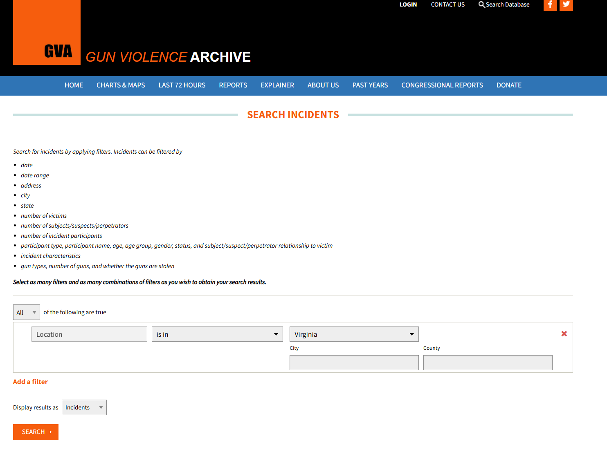
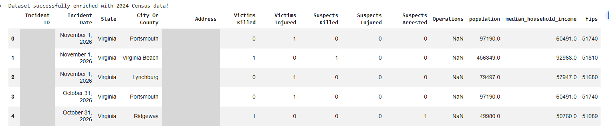
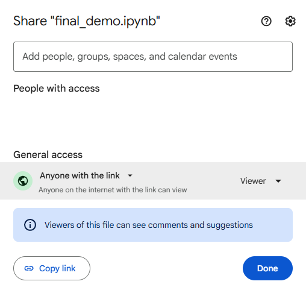
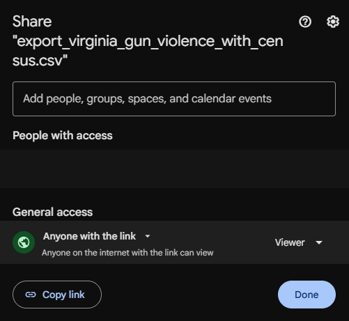
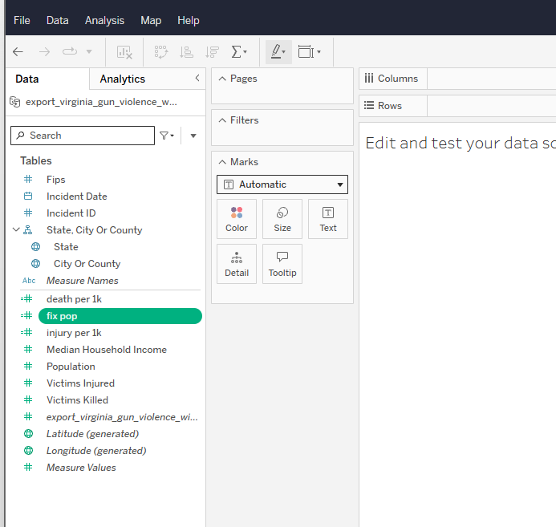
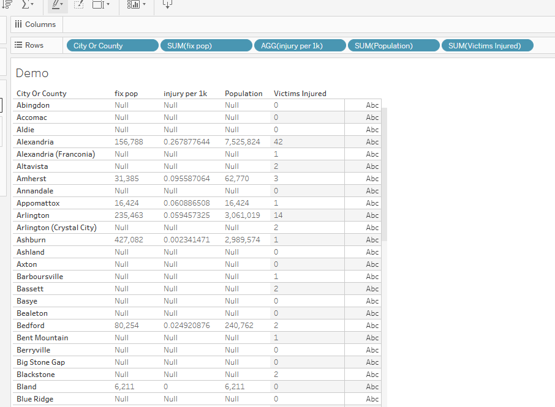
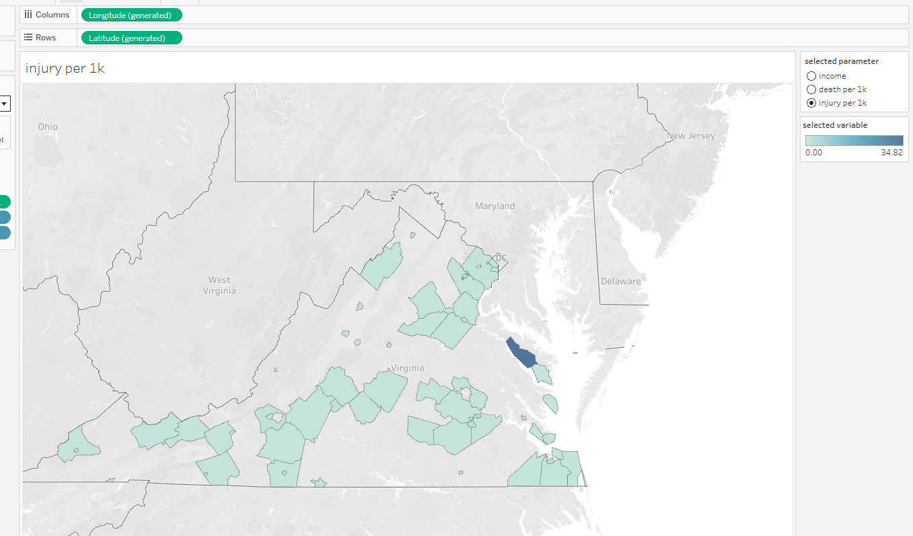
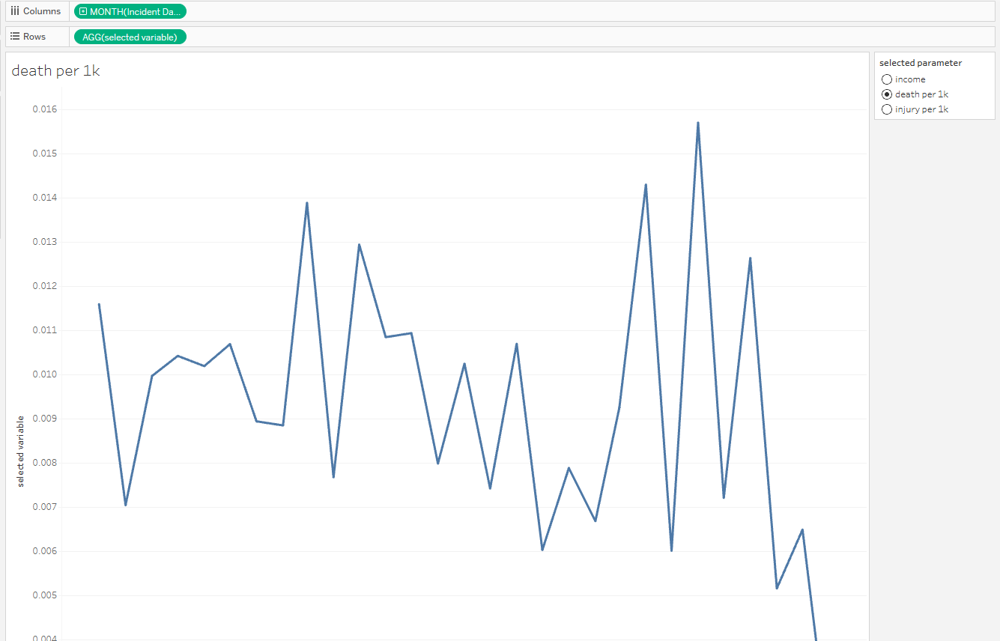

# Final Project: Gun Violence, Population, and Income

**IA342 · Visualization Methods and Tools · Fall 2026**  
**Individual project · 100 points**  
**Submission deadlines: December 4, 11, and 16, 2026 · 11:59 PM EST (Eastern Time)**

> **Late submissions are not accepted.** Missing, late, or inaccessible submissions receive **0 for the affected assignment**. Resubmissions for regrading are not accepted.
>
> Feedback will be provided as promptly as possible after each submission; however, feedback before the next deadline is not guaranteed. Students may use feedback to improve their work for subsequent assignments. Revisions made after an assignment’s deadline will not affect its grade.

## Project overview

Analyze the state randomly assigned to you. Enrich its Gun Violence Archive (GVA) data with Census data in **Colab**, build an interactive **Tableau Public dashboard**, and present your findings in a **2–3 minute video**.

| Canvas assignment | Submit | Due date | Points |
| --- | --- | --- | ---: |
| **Assignment 1 — Colab Data Preparation** | Your shared **Colab notebook URL and CSV file URL** | **Fri, Dec 4** | 30 |
| **Assignment 2 — Tableau Public Data Source and Dashboard** | Your **Tableau Public profile URL** | **Fri, Dec 11** | 50 |
| **Assignment 3 — Video Presentation** | Your finished **MP4 video** | **Wed, Dec 16** | 20 |
| **Total** | | | **100** |

## Assignment 1 — Colab Data Preparation · 30 points

**Due: Friday, December 4, 2026, at 11:59 PM EST.**

### 1. Download and load your GVA data

Open the [GVA query page](https://www.gunviolencearchive.org/query). Set the Location filter to your assigned state, leave City and County blank, and display results as Incidents. Run the search and export the results as a CSV file. Upload the original CSV to **your Google Drive**.

*Example: select your assigned state, search for incidents, and download the CSV from the results.*

Create a Colab notebook. Tell Gemini your **state, incident-date range, and Drive file path**. Ask it to mount Google Drive, load the CSV, and inspect the data. Run the code and save the outputs.

Show the source, download date, incident-date range, row count, distinct Incident ID count, and a data preview. Remove duplicate incidents, retain valid zero counts, and note any gaps in the downloaded data.

### 2. Retrieve and verify Census data

Use your **IA340 Census API key**, or [request a new key](https://api.census.gov/data/key_signup.html). Store it in **Colab Secrets**. Refer to [IA340 Module 5](https://jmu-data.github.io/IA340/modules/module-5/) for the API and Secrets workflow.

Use **2024 ACS 5-year data** for all Census fields. Confirm that your code requests `/2024/acs/acs5`.

Ask Gemini to help you retrieve these fields from the [Census API](https://www.census.gov/data/developers/data-sets/acs-5year.html) for the counties and county equivalents in your state:

| Required field | Census variable / identifier |
| --- | --- |
| **Population** | `B01003_001E` |
| **Median Household Income** | `B19013_001E` |
| State and county name | `NAME`, with the correct state |
| County or city FIPS (`fips`) | Five-digit Census county/county-equivalent code; preserve leading zeros |

Use Gemini to match the GVA **State** and **City Or County** fields to the 2024 Census data and add a five-digit `fips` for each matched location. Keep leading zeros; leave unmatched values blank.

**Manually verify a few Census data values** against the Census API or an official Census table. Check the accuracy of the matched FIPS, population, and median household income.

### 3. Combine, save, and reopen the CSV

Preserve all original GVA columns, including **Incident ID**, **Incident Date**, **Victims Killed**, and **Victims Injured**. Append these three columns from the 2024 Census data: **`population`**, **`median_household_income`**, and **`fips`**. Keep one row per incident and check that the number of incidents has not changed after matching.

Save the combined CSV to **your Google Drive**, then **reopen that saved file in Colab**. Display its columns, row count, and a preview showing the matched Census values. Use this CSV in Assignment 2.

**Example output**

*Example of the combined GVA records with 2024 Census population, median household income, and FIPS added (incident IDs and addresses obscured for publication).*

**Gemini prompt to adapt**

> My state is [state]. My GVA CSV covers [dates] and is saved at [Drive path]. Help me load the file from Drive and retrieve **2024 ACS 5-year** population, median household income, and FIPS using my Census API key stored in Colab Secrets. Preserve the original columns and add `population`, `median_household_income`, and `fips`. Help me verify selected data values against Census, save the combined CSV to Drive, and reopen it. Keep my API key private.

### 4. AI Use Summary

At the end of your Colab notebook, write a brief **AI Use Summary** in a Markdown cell. Identify the AI tools you used, explain how you used them to collect and process the data, and report how you verified selected results and whether they were correct.

### 5. Share and submit

Share both your **Colab notebook** and your **final combined CSV file** in Google Drive. For each file, set **Share → General access → Anyone with the link → Viewer**, then copy the link. Test both links in an incognito/private window. Keep your notebook code, saved outputs, and AI Use Summary visible.

**Share the Colab notebook**

**Share the final CSV file**

*Example of sharing the combined CSV directly from Google Drive.*

In **Canvas → Assignment 1 — Colab Data Preparation**, submit both URLs in the same submission:

- Colab notebook URL
- Google Drive URL for the combined CSV file

### Assignment 1 rubric · 30 points

| Criterion | Points | Full-credit evidence |
| --- | ---: | --- |
| **Colab Notebook** | **10** | Accessible notebook with code and saved outputs showing the GVA data loaded, Census data retrieved, combined, saved, and reopened. |
| **CSV Dataset** | **15** | Accessible combined CSV containing the assigned state's downloaded GVA records and the required 2024 ACS population, median household income, and five-digit FIPS fields. One row per incident; unmatched values remain blank. |
| **AI Use Summary** | **5** | Identifies the AI tools used, explains their role in data collection and processing, and reports verification of selected data results. |
| **Assignment 1 total** | **30** | |

**Credential penalty:** Exposing an API key or other credential in the notebook, outputs, screenshots, or shared data deducts **10 points from Assignment 1**, to a minimum of zero. Remove and revoke or rotate any exposed key.

## Assignment 2 — Tableau Public Data Source and Dashboard · 50 points

**Due: Friday, December 11, 2026, at 11:59 PM EST.**

### Part A. Data source and calculations

Follow [IA342 Lab 12](https://jmu-data.github.io/IA342/assignments/lab-12/) to connect the combined CSV in Google Drive to Tableau Public. Prepare the data source:

- **Exclude** `Operations` (empty in the example) and `Address` from the **published** data source. Keep your original CSV in Drive.
- Set `Incident Date` to **Date**.
- Assign `State` the **State/Province** geographic role and the appropriate **County** or **City** geographic role to your location field. Create a **State → County/City hierarchy**, as appropriate for your data.
- Set `Incident ID` and `fips` to **Dimensions**. Store `fips` as five-digit text, including leading zeros.
- Keep `Victims Killed` and `Victims Injured` as numeric measures. You may also keep `Suspects Killed`, `Suspects Injured`, and `Suspects Arrested` for additional charts.
- Confirm that `population` and `median_household_income` are numeric.

Create both measures using the **FIXED level-of-detail (LOD)** approach from [IA342 Lab 11](https://jmu-data.github.io/IA342/assignments/lab-11/):

| Required measure | Meaning |
| --- | --- |
| **GVA deaths per 1,000 residents** | Recorded deaths relative to the county population for the incident period |
| **GVA injuries per 1,000 residents** | Recorded injuries relative to the county population for the incident period |

Create **`fixed pop`** using a FIXED LOD by **`fips`**, following Lab 11. Do not add the same population once for every incident row. Calculate both measures **per 1,000 residents**, not as percentages; leave rates missing when population is unavailable or nonpositive.

Save `fixed pop` and both rate calculations with your Tableau data source. Verify a few calculated values. Use matched FIPS and valid population for the rate calculations. Do not sum repeated population or income values across incident records.

Some counties may have no matched data. **Missing values and blank areas are acceptable**; they do not indicate zero incidents.

*Illustration: a prepared data source with FIXED population and both rate calculations.*

*Illustration: a table for verifying FIXED population and rate calculations. Null values may occur where Census data could not be matched.*

### Part B. Interactive dashboard

Build an **interactive dashboard with at least three charts and no more than five views in total**. Include the following three required charts:

| Chart | Requirement |
| --- | --- |
| **1. Geographic view** | Show county-level median household income, deaths per 1,000 residents, and injuries per 1,000 residents, using the full available incident period. |
| **2. Time-series chart** | Show the selected metric over time for your assigned state, using the available data (for example, a monthly line chart). |
| **3. Chart of your choice** | Explore an additional question, such as the relationship between income and a rate in a scatter plot, or total deaths by county in a bar chart. |

You may add up to two additional views. The screenshots below are **for illustration purposes only**; you may use different chart designs.

**Parameter control.** Following [Lab 12](https://jmu-data.github.io/IA342/assignments/lab-12/), use one parameter to switch both the geographic and time-series views among **Median Household Income**, **Deaths per 1,000 Residents**, and **Injuries per 1,000 Residents**. Use dynamic titles that reflect the selected metric.

**Example 1 — County map**

*Illustration: a geographic view with a metric selection parameter. Some counties may have no matched data.*

**Example 2 — Time-series chart**

*Illustration: a monthly line chart using the same parameter. Income reflects the locations represented in each period, not changes in 2024 household income. Rates describe the population represented by the matched data.*

**Interactivity.** A county filter action is required. Selecting a county in the geographic view must update the time-series chart. Clearing the selection should restore the view for the state. Additional interactions are optional.

**Design.** Apply the **five-second principle**. Use appropriate colors, readable legends, clear titles and units, and a well-organized layout. Identify the state, data sources, and dates.

### Publish and submit

Publish the **data source and dashboard/workbook** to your Tableau Public profile with clear final-project names. Check the published data for unnecessary addresses or credentials, and make sure the source and calculated fields can be inspected.

Test the profile in an incognito/private window. Confirm that the dashboard opens and that the parameter and filter action work. Report publication or access problems to the instructor before the deadline.

In **Canvas → Assignment 2 — Tableau Public Data Source and Dashboard → Website URL**, submit your **Tableau Public profile URL**.

### Assignment 2 rubric · 50 points

**Data source — 20 points**

| Criterion | Points | Full-credit evidence |
| --- | ---: | --- |
| **Published and prepared data source** | **10** | Accessible source; `Operations` and `Address` excluded; correct date type, dimensions, geographic roles, measures, and State → County/City hierarchy where appropriate. |
| **Both FIXED LOD rate calculations** | **10** | Correct deaths and injuries per 1,000 residents using county-level FIXED population; formulas are saved in Tableau, avoid repeated-population errors, and are used in the dashboard. |
| **Data source subtotal** | **20** | |

**Dashboard — 30 points**

| Criterion | Points | Full-credit evidence |
| --- | ---: | --- |
| **Required charts** | **10** | Includes the geographic view, time-series chart, and at least one chart of the student’s choice; no more than five views in total. |
| **Parameter controls and filter actions** | **10** | The parameter switches all three metrics in the geographic and time-series views; dynamic titles update; the required county filter works and resets correctly. |
| **Dashboard design and clarity** | **10** | Five-second principle, readable layout, appropriate colors, legends, labels, units, and source/date notes. |
| **Dashboard subtotal** | **30** | |
| **Assignment 2 total** | **50** | |

## Assignment 3 — Video Presentation · 20 points

**Due: Wednesday, December 16, 2026, at 11:59 PM EST.**

### 1. Create your presentation

Create a **Google Slides presentation of 5–10 slides** that tells a complete story about your project. Use actual screenshots of your Tableau dashboard and its charts to explain your analysis and findings. You may capture screenshots of your dashboard’s charts under different parameter or filter selections to illustrate your findings.

Your presentation should cover:

- Introduction to your project and assigned state.
- Data collection: GVA and 2024 Census data.
- Data preparation and calculated fields: how you combined the data and calculated your rates.
- Dashboard and findings: explain each of the three required charts individually and what you learned from them.
- Conclusion: summarize your main findings.

### 2. Produce your video

Write a narration script for **every slide**. Use AI voice-over to narrate each slide; a speaking AI avatar may also deliver the narration. Your narration should explain the visuals and findings, not simply read the slide titles.

Use [IA342 Lab 13 — Flow and Vids](https://jmu-data.github.io/IA342/assignments/lab-13/) as a reference. Assemble the presentation into a **2–3 minute MP4 video**. Make sure the charts are readable and the narration is clear. Export and watch the finished video to check the duration and sound.

**Optional enhancements:** AI avatars, Flow-generated video clips, Gemini-generated infographics, or background music. These are optional and do not affect your score. If you use generated visuals, keep them relevant and non-graphic and distinguish them from actual project data.

### Submit the video

In **Canvas → Assignment 3 — Video Presentation → File Upload**, upload only your finished **MP4 video**. Check that it plays with sound.

### Assignment 3 rubric · 20 points

| Criterion | Points | Full-credit evidence |
| --- | ---: | --- |
| **Storytelling and findings** | **10** | Complete, logical presentation of data collection, preparation, calculated fields, actual dashboard charts, findings, and conclusion. Each required chart is clearly explained. |
| **Video presentation** | **10** | Uses 5–10 slides, includes clear narration on every slide, shows readable screenshots of the student's own charts, and is a playable MP4 lasting 2–3 minutes. |
| **Assignment 3 total** | **20** | |

## Class schedule

| Date | Format | Attendance |
| --- | --- | --- |
| **Monday, November 30, 2026** | In-person class | **Required** |
| **Wednesday, December 2, 2026** | In-person class | **Required** |
| **Monday, December 7, 2026** | Optional Zoom help during regular class time; Zoom link on Canvas. No separate office hours. | **Not required** |
| **Wednesday, December 9, 2026** | Optional Zoom help during regular class time; Zoom link on Canvas. No separate office hours. | **Not required** |

If you have questions on December 7 or 9, join the Zoom meeting during our regular class time using the link posted on Canvas.

## Final submission check

Submit each assignment by its own deadline: **December 4, 11, and 16, 2026, at 11:59 PM EST**, respectively. Confirm successful Canvas submissions, both Assignment 1 URLs, the Tableau Public profile URL, and a playable MP4. Keep the submitted work and sharing settings available for grading.
