# Lab 12 — GVA Dashboards in Tableau Public and Gemini Canvas

**IA342 · Week 12 · Monday: Tableau Public · Wednesday: Gemini Canvas**

**Deadline:** Friday, November 13, 2026, **11:59 PM EST (Eastern Time)**.

**Goal:** Use the same Gun Violence Archive (GVA) Last 72 Hours CSV to create an interactive Tableau Public dashboard and a Gemini Canvas dashboard. Your work should demonstrate accurate measures, useful interactions, clear visual explanations, and responsible AI use.

## Monday — Tableau Public

### 1. Create your own Tableau Public account

1. Go to [Tableau Public](https://public.tableau.com/) → **Create an Account / Sign Up**. Register a new, **free personal Tableau Public account**. A personal Gmail address is recommended, but a JMU email is fine.
2. Verify your email, sign in, and open **My Profile**. Use a public display name or username **of your choice**. Your legal name, headshot, and school email **are not required** in your public profile. Remember that your profile and published projects can be viewed by other people.

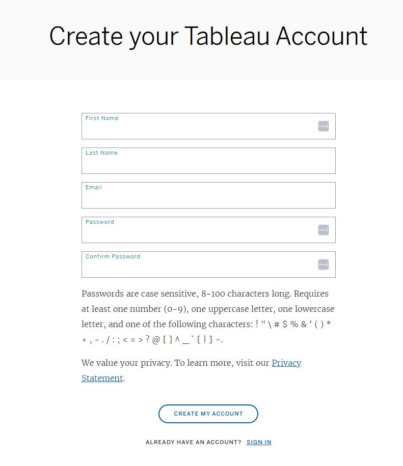

3. Browse [Tableau Public Discover / Viz of the Day](https://public.tableau.com/app/discover). Look at one visualization to get a design idea. You will build your own visualization, not copy another author's work.

### 2. Download the GVA CSV and put it in Google Drive

1. Open [Gun Violence Archive — Last 72 Hours](https://www.gunviolencearchive.org/last-72-hours) and download the incident table with **Export as CSV**.
2. Open **your own Google Drive**. Create a folder, for example `IA342`, and **upload the original CSV without editing it**. The folder and file names are **your choice**. Prepare the fields after connecting the file in Tableau.

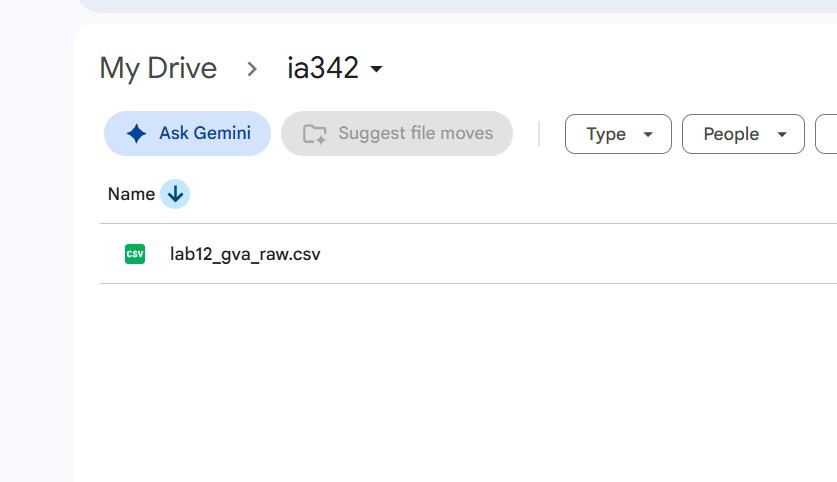

3. Leave the original file in Drive. You will connect it to Tableau and later give the same GVA records to Gemini. Note the **earliest and latest incident dates**, which describe the period in your charts. Different download times can produce different counts.

### 3. Connect your Google Drive CSV in Tableau Public

1. Return to Tableau Public and open the **Create** menu. Choose **Create → Data Source** if it is available. **If you do not see Data Source**, choose **Create → Viz** instead. Both paths let you connect your GVA file and build the charts; the latter keeps the source inside your Workbook. **Both routes are accepted for grading.**

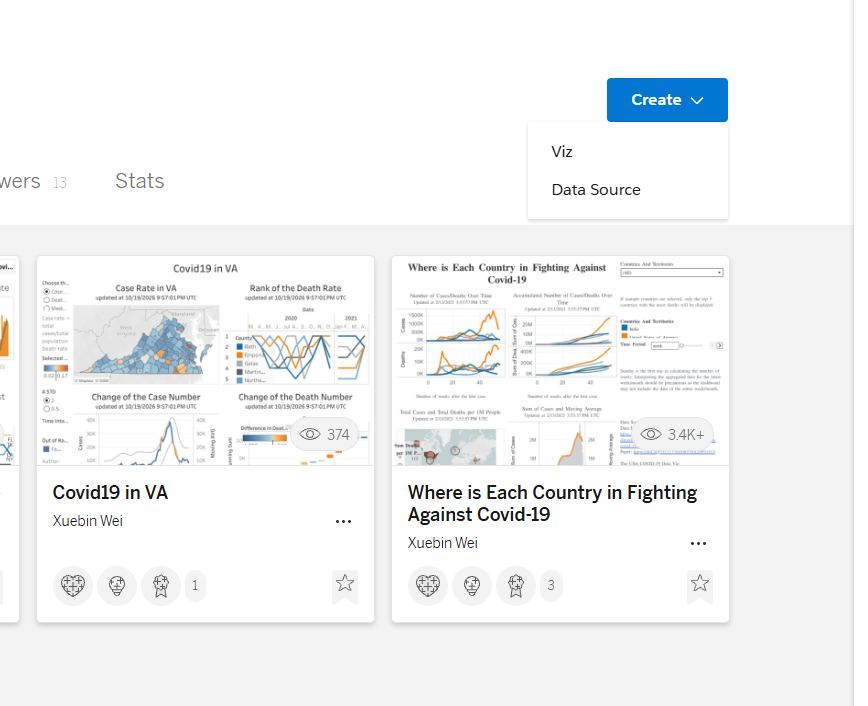

2. After choosing one of those options, you should reach **Connect to Data**. Choose **Connectors → Google Drive** and sign in to the Google account that owns your CSV.

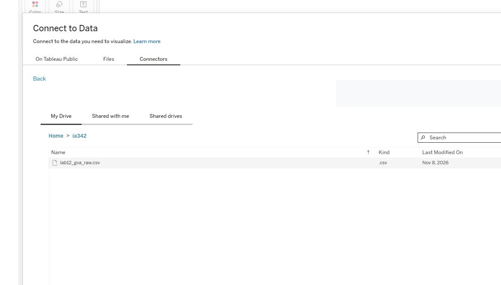

3. Under **My Drive**, find your `IA342` folder (or whichever folder you chose), select the CSV, and click **Connect/Open**. You should see one GVA table in the Tableau **Data Source** workspace; **do not join another file**.

### 4. Prepare the Data Source, create an Extract, and publish

In the **Data Source** page, check the field list and preview grid. **We will keep these six fields**; the other fields are not needed for this lab.

| **Field to keep** | **Data type / role to set** |
|---|---|
| `Incident ID` | String; Dimension |
| `Incident Date` | Date (full calendar date) |
| `State` | Geographic role: State/Province (United States) |
| `City Or County` | String; Dimension (not a verified county boundary) |
| `Victims Killed` | Whole Number |
| `Victims Injured` | Whole Number |

1. Check the data-type icon for each retained field. For example, change `Incident Date` from String to Date if it was imported incorrectly; set `Victims Killed` and `Victims Injured` to Number (Whole). Do not discard legitimate records with zero victims.
2. From each unwanted field's dropdown menu, choose **Hide** for `Address`, `Suspects Killed`, `Suspects Injured`, `Suspects Arrested`, `Operations`, and other unused columns. This is Tableau's **Hide** operation; the original file in Google Drive stays unchanged.

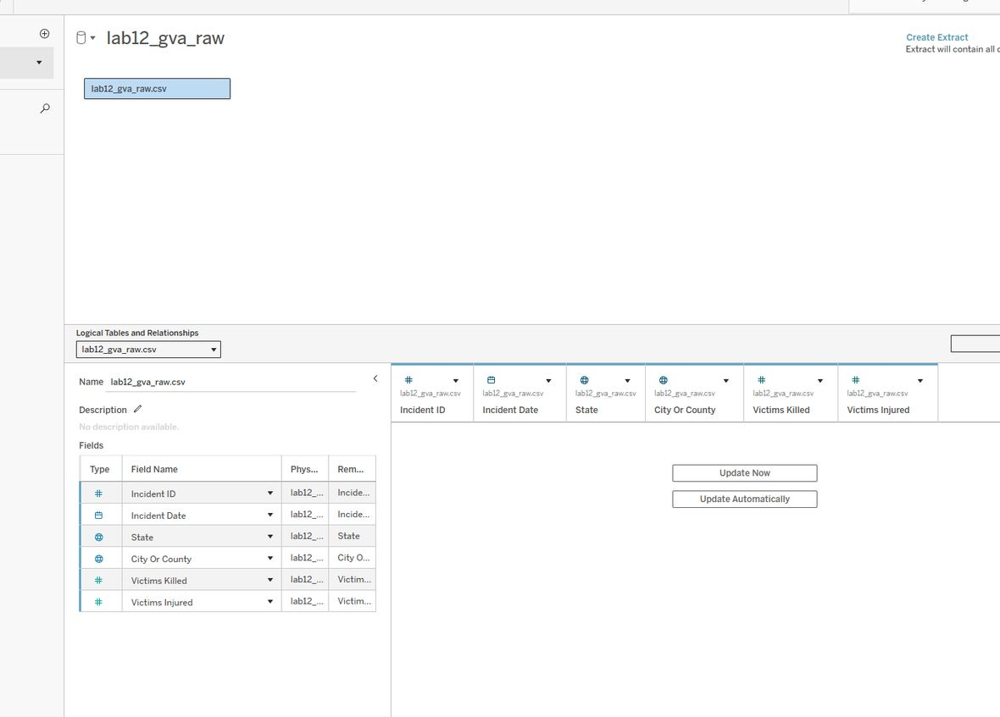

3. Confirm that the six wanted fields are the ones retained for analysis. Click **Create Extract** and confirm the dialog. Hide unused fields **before** making the Extract, and check the result before making anything public.

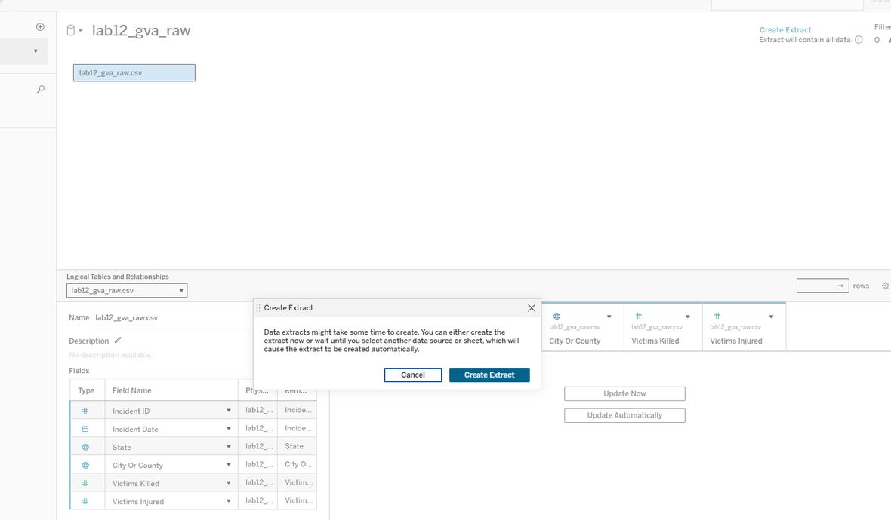

4. If you started with **Create → Data Source**, choose **Publish New Data Source**. A suitable public name is **`Lab 12 GVA`**; you may choose another name without including your real name. **Description and tags are not required.** Publish, then open your **Data Sources** page and choose **Create Viz** from your published source.

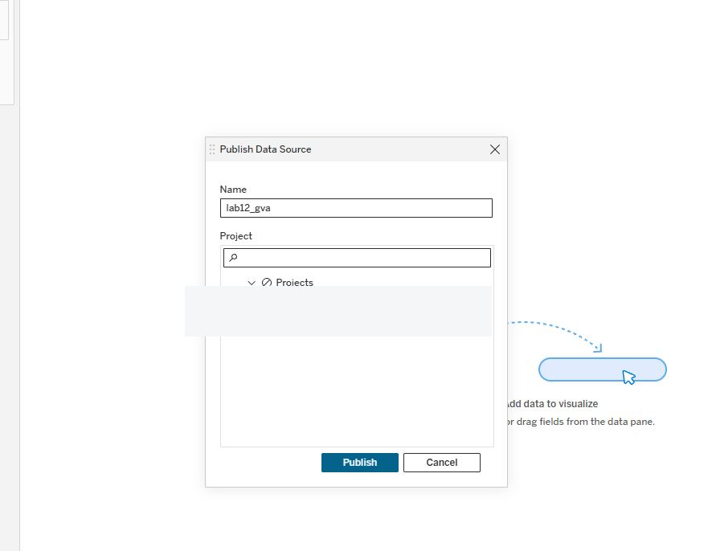

The next screenshot shows how published sources appear on the Data Sources tab; use **Create Viz** from your source to begin building charts.

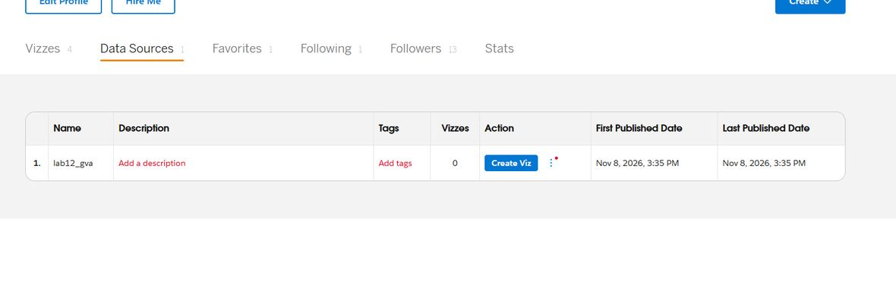

5. If you instead started with **Create → Viz**, stay in the Viz, use the cleaned/extracted connection in its **Data Source** tab, and go to **Sheet 1**. Your Data Source may remain embedded in the Workbook; **this is acceptable**. Either way, continue to the next section.

**Privacy reminder:** Tableau Public publishes information publicly. Hidden columns must be checked in the published/extracted result rather than assumed private; do not include street addresses, private details, or credentials. The underlying Google Drive CSV need not be shared publicly. Follow GVA's data-use terms.

### 5. Create the `Choose Measure` parameter and `Selected Measure` calculation

Create the following parameter and calculated field in the **Workbook** so every worksheet responds to the same metric selector.

1. On the worksheet, open the **Data pane → Create Parameter**. Name it **`Choose Measure`**, choose **String** and **List**, and **keep these three choices**: `Reported incidents`, `Victims killed`, `Victims injured`. Set the current/default value to `Reported incidents`.

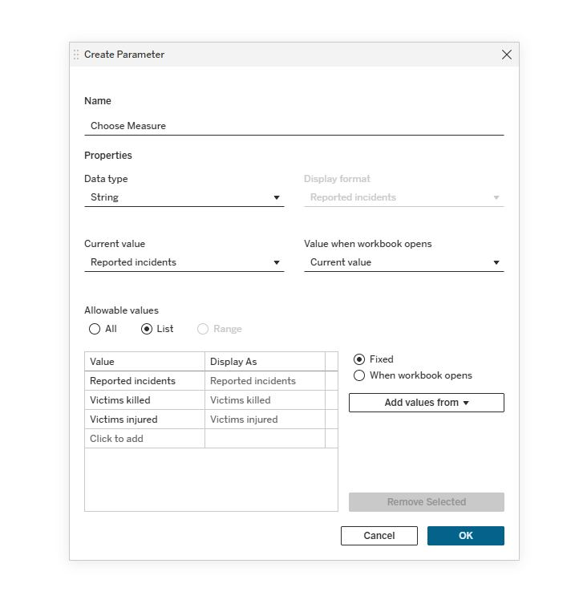

2. Click **OK**. Right-click `Choose Measure` in the Data pane and select **Show Parameter**; a visible selector should appear.
3. In the Data pane choose **Create Calculated Field**, name it **`Selected Measure`**, and paste the formula:

```tableau
CASE [Choose Measure]
WHEN "Reported incidents" THEN COUNTD([Incident ID])
WHEN "Victims killed" THEN SUM([Victims Killed])
WHEN "Victims injured" THEN SUM([Victims Injured])
END
```

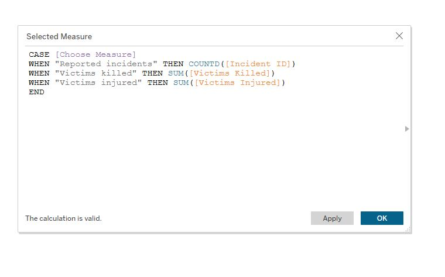

4. Check for **The calculation is valid**, then click OK. Tableau will show the result in worksheets as **`AGG(Selected Measure)`**. It already contains `COUNTD` or `SUM`, so **do not add a second SUM**.

### 6. Worksheet 1 — state symbol map

1. Rename **Sheet 1 → `1 State map`**. Double-click `State`. Tableau creates a map; keep **State → Detail** on the Marks card and select **Circle** marks.
2. Drag **`Selected Measure` → Size** on Marks. It should show **`AGG(Selected Measure)`** on Size, not a fixed `Victims Killed` or `Incident ID` measure.

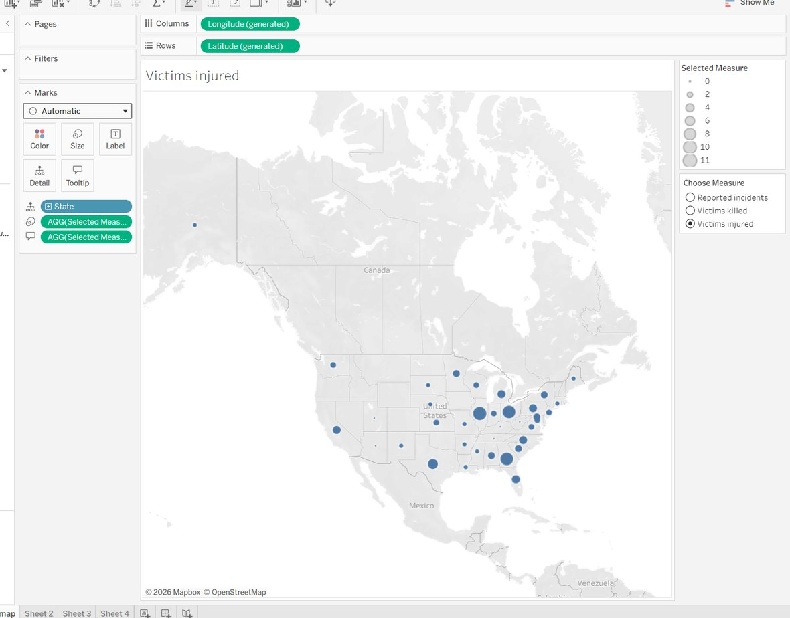

3. On this sheet, **Show Parameter → Choose Measure**. Switch among the three values. Each state circle's size should change accordingly. This is the whole point of our single-measure selector.
4. Choose **Worksheet → Show Title**, then **Edit Title**. Type `GVA — `, insert the **Choose Measure parameter** from the title editor, and type ` by state`. This title updates with the selector.

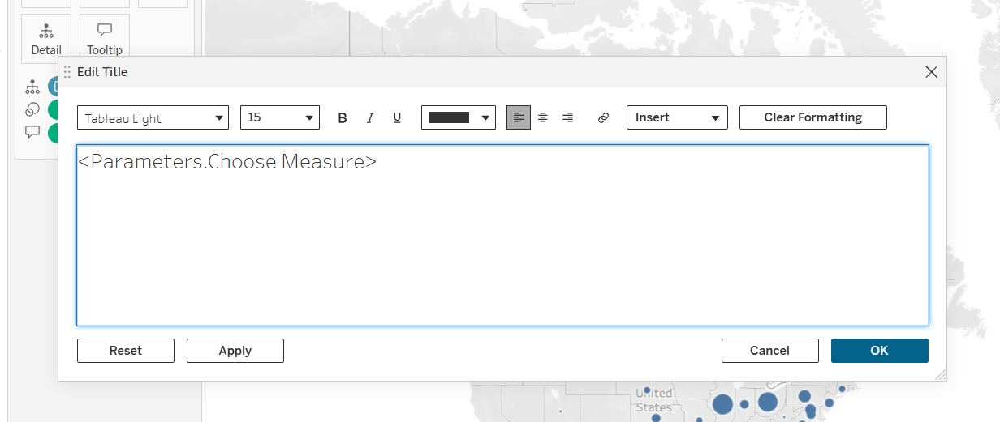

### 7. Worksheet 2 — state comparison bar chart

**Goal:** Make one ranked horizontal bar chart, then add readable numbers to the bars.

1. Click **New Worksheet** and rename it **`2 State comparison`**. Drag **`State` → Rows** and **`Selected Measure` → Columns**. On **Marks**, choose **Bar**. Sort states **descending by the current selected measure**. First, look at the bars *before* value labels are enabled:

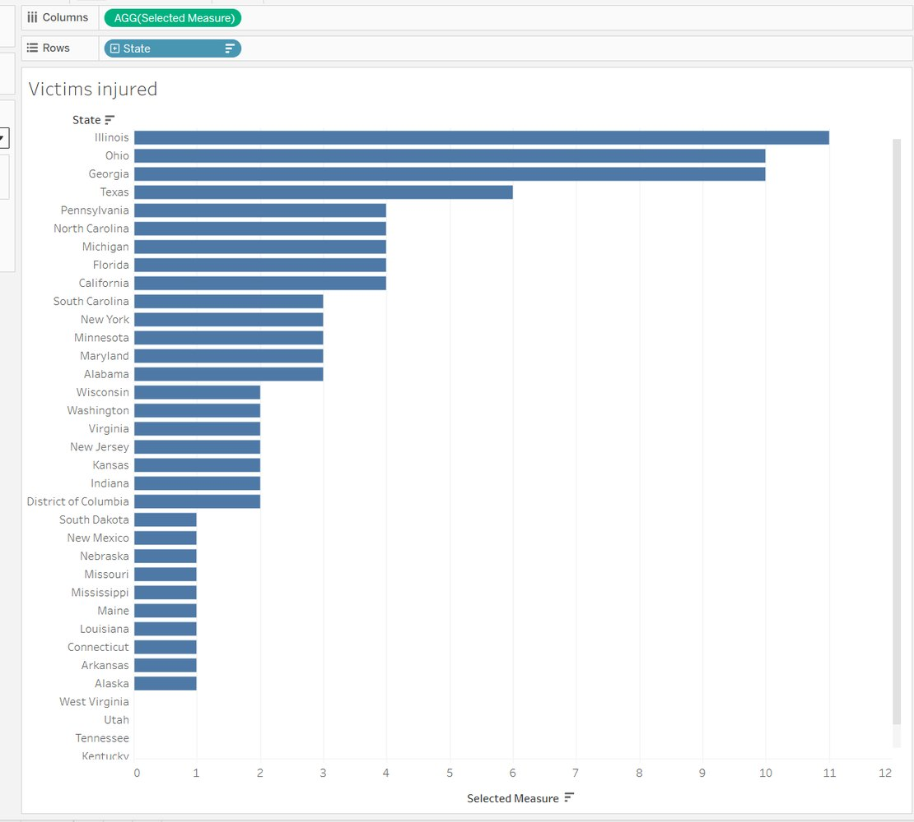

2. Click **Marks → Label** and check **Show Mark Labels**. The screenshot below shows the exact checkbox to enable:

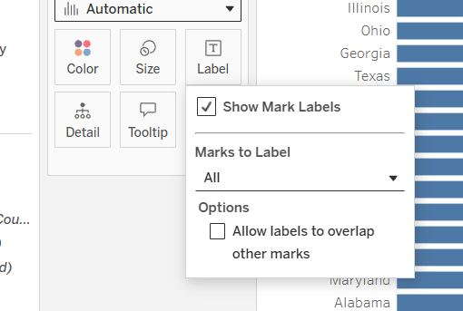

3. Return to the chart. Every displayed bar should now show its numeric value (depending on available space):

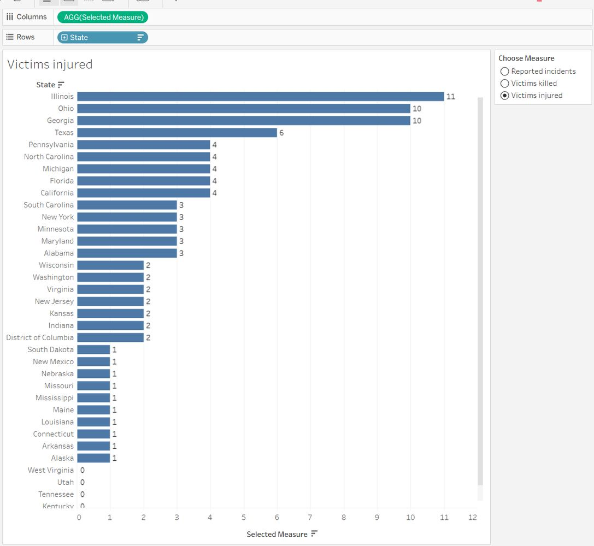

4. Right-click **`Choose Measure` → Show Parameter** on **this worksheet**, even if you showed it on Worksheet 1. Change among `Reported incidents`, `Victims killed`, and `Victims injured`: both the bar lengths and value labels must change. Edit the title to **`State comparison — `** followed by **Insert → Parameters → Choose Measure**.
5. Hover over a bar to see the **Tooltip** (the popup for that mark). It should tell a reader the **State** and the currently selected count. You may edit the wording in **Marks → Tooltip**; keep the live numeric field reference, rather than typing a fixed value.

### 8. Worksheet 3 — daily pattern bar chart

**Goal:** Compare the number of incidents, victims killed, or victims injured **on each calendar date** in your CSV. This is a daily chart, not an hourly chart.

1. Click **New Worksheet** and rename it **`3 Daily pattern`**. Drag **`Incident Date` → Columns**, open the date pill's dropdown, and choose **Exact Date**. This menu illustrates the available date levels; the dates shown in the example menu may differ from your GVA CSV:

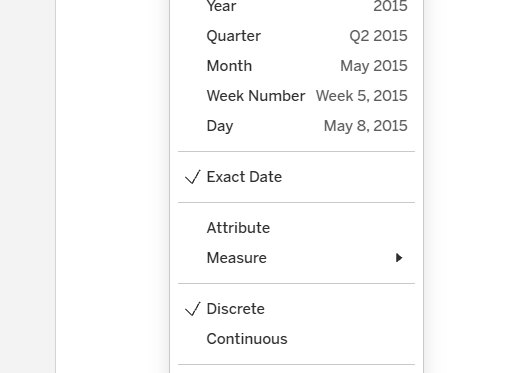

2. On the same `Incident Date` pill, make sure **Discrete** is selected (the pill should be **blue**). Keep the complete date, not just the month or day-of-month:

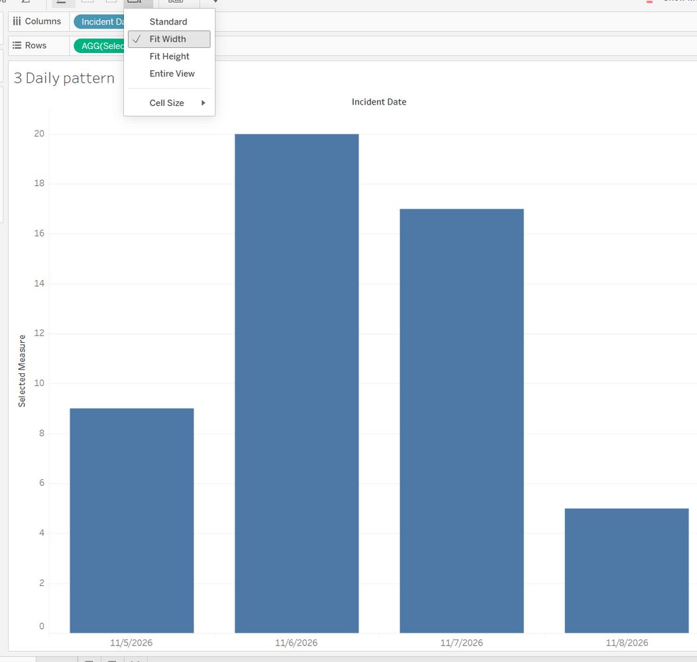

3. Drag **`Selected Measure` → Rows**, then choose **Marks → Bar**. At first, the bars may occupy only a narrow part of your worksheet, as in this screenshot:

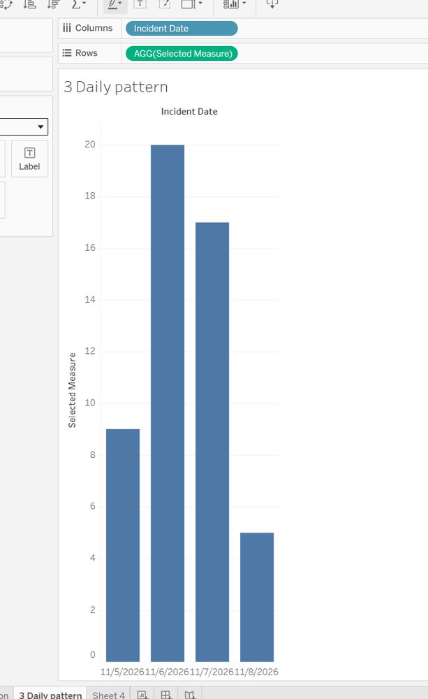

4. At the worksheet toolbar's **Fit** menu (which may say **Standard**), select **Fit Width** or **Entire View**. Sort `Incident Date` by its actual date in **ascending** order so the oldest date is leftmost. Confirm that the wider chart has readable date labels and a chronological sequence:

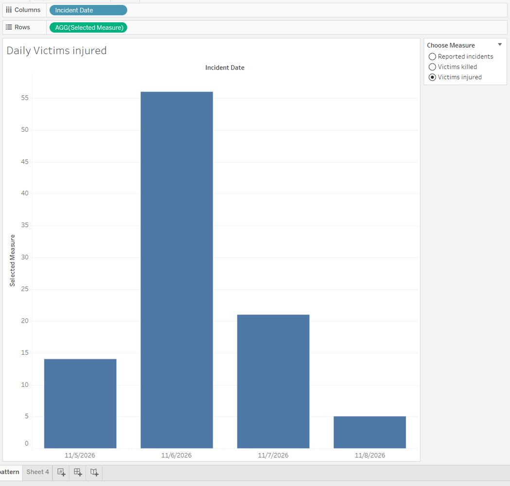

5. Right-click **`Choose Measure` → Show Parameter** on Worksheet 3. Switch among all three metrics and observe how the daily bar heights change.
6. Click **Marks → Tooltip** to edit the popup a viewer sees when hovering over a daily bar. Keep the live Tableau field tokens, but make the text explain the **incident date** and **selected count**. You may edit the text directly; do not type a made-up number:

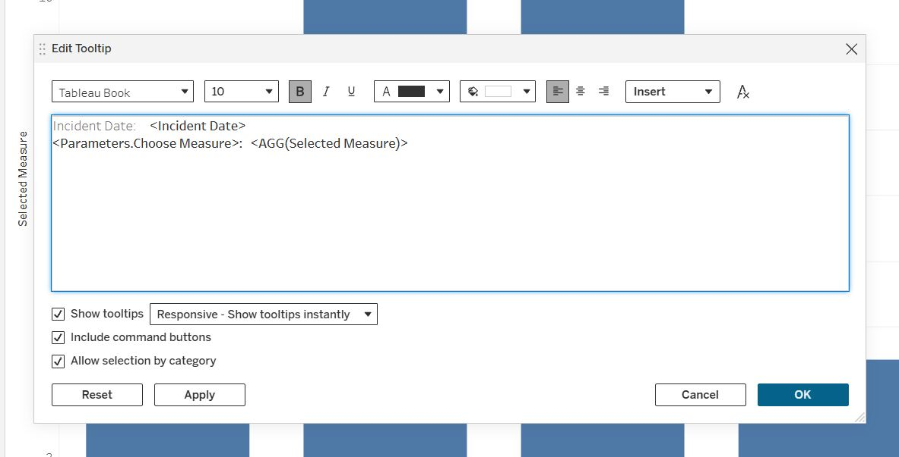

7. Use **Worksheet → Show Title / Edit Title** and type **`Daily `**, then insert **Choose Measure** from the title editor's parameter menu. The title should change when you switch measures:

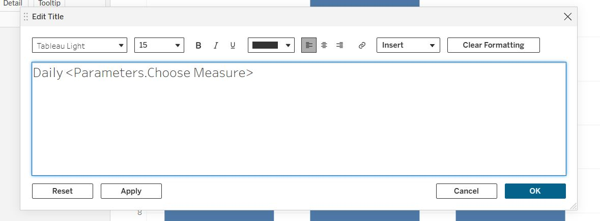

### 9. Worksheet 4 — cumulative daily waterfall

**What are we making?** Worksheet 3 shows each *day's* value. A **waterfall** shows how those daily values accumulate. For daily counts of 5, 3, and 2, the total progresses **5 → 8 → 10**. This is a cumulative contribution chart, not a chart of percentage changes.

1. Go to your **`3 Daily pattern` sheet tab** at the bottom. **Right-click the tab → Duplicate**; rename the new copy **`4 Daily waterfall`**. Now you can change it without destroying the daily bar chart.

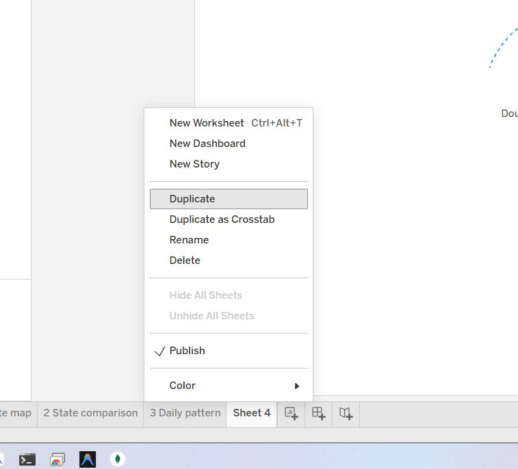

2. In the Data pane create a calculated field **`Running Selected Total`** with:

```tableau
RUNNING_SUM([Selected Measure])
```

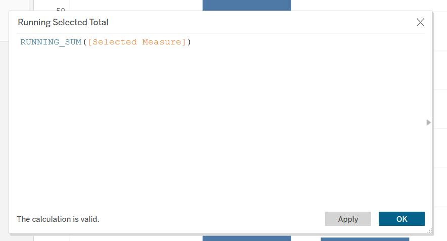

3. Create another calculated field **`Waterfall Span`** with:

```tableau
-[Selected Measure]
```

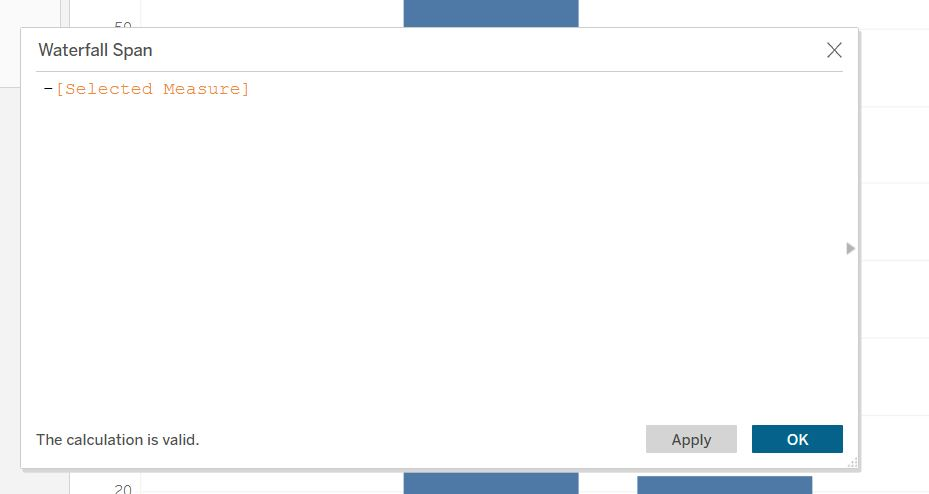

4. On the new **`4 Daily waterfall`** sheet, leave **`Incident Date` (Exact Date, Discrete) → Columns**. Remove `AGG(Selected Measure)` from Rows, then drag **`Running Selected Total` → Rows**. On **Marks**, change **Bar → Gantt Bar**, then drag **`Waterfall Span` → Size**.

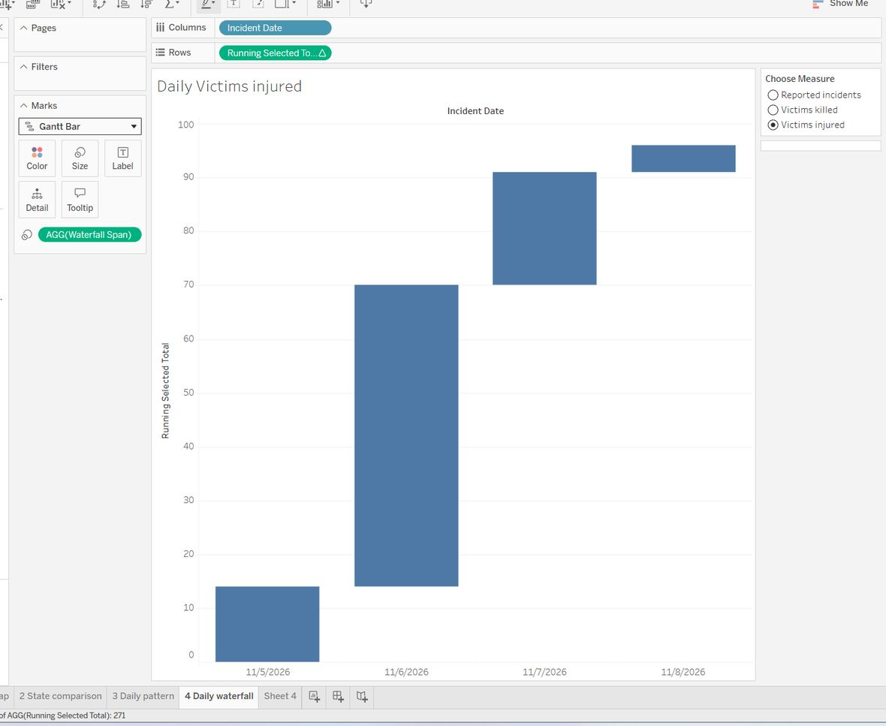

5. Click the dropdown on `AGG(Running Selected Total)` in Rows → **Edit Table Calculation / Compute Using → Table (Across)**. This means Tableau calculates the running total from left to right by the chronological dates.

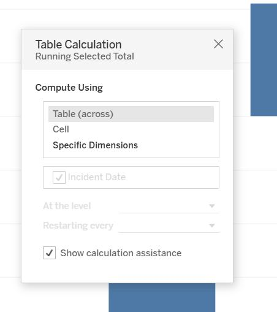

6. **Show Parameter → Choose Measure** on the waterfall sheet. Edit the title to `Cumulative ` plus the **Choose Measure** parameter. Test all three metric values.
7. For this chart's tooltip, open **Marks → Tooltip**, **edit the existing text directly**, and leave its live references intact. Make it tell a viewer: **Incident Date**, **selected metric**, and **cumulative total**. The screenshot below shows the field-token structure used in your test. No new calculation is necessary.

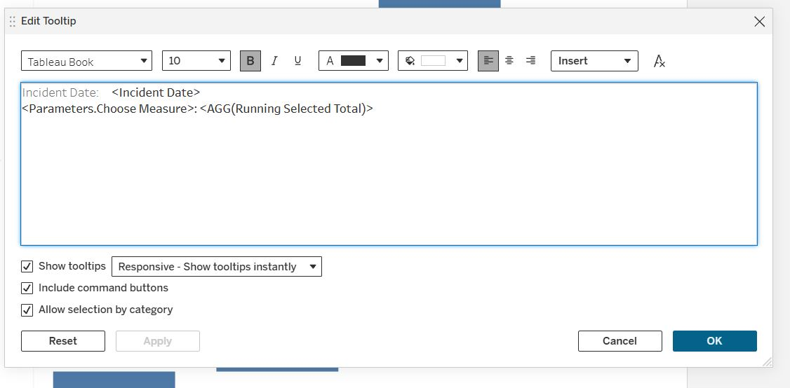

The result should be a staircase of daily contributions ending at the selected total. If it runs in the wrong direction, recheck the date order and **Table (Across)**.

### 10. Assemble and publish your Tableau dashboard

1. Choose **New Dashboard**, rename it **`GVA Overview`**, and drag in all four sheets. Arrange the **state map + state bars** above the **daily bars + waterfall**. Check that titles, labels, and axes are readable.
2. Because you showed **Choose Measure** on every worksheet, you should need **only one visible Choose Measure control** on the finished dashboard. If the editor shows duplicates, hide the extras. Switching it should update every sheet.
3. Select the **map** within the dashboard and choose **Use as Filter** (funnel icon). Click one state on the map. The **other three charts must filter to that state**; clearing the mark returns to all states. **No separate State Filter control is required.**
4. Add a **Text** object naming the data source, such as **`Data source: Gun Violence Archive — Last 72 Hours`**, and the incident-date range represented by your CSV. Remind readers that the snapshot is not a population-normalized rate.

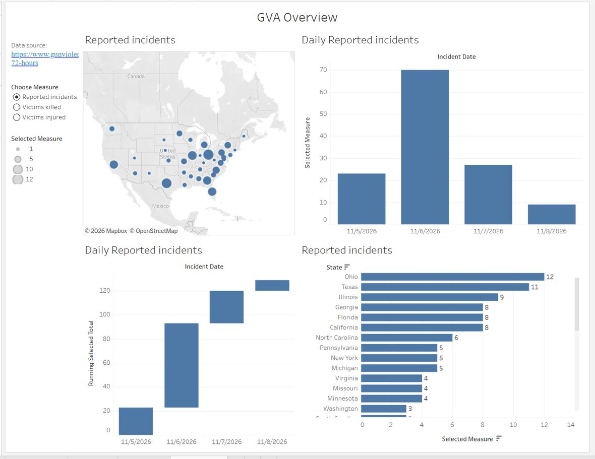

5. Publish the Workbook. For example, name it **`Lab 12 GVA Dashboard`**; your name is **not required** in the public title. Check that the published workbook appears in your personal Tableau Public profile and opens without account-owner permissions.

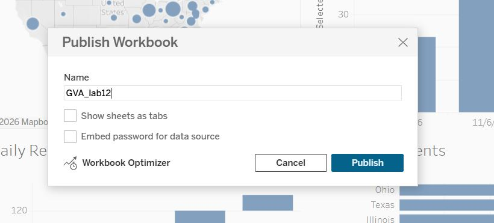

Keep the layout focused: **fewer than five views**, clear color choices, readable titles, useful tooltips, and interactions viewers can understand within five seconds.

## Wednesday — Gemini Canvas

### 11. Build your AI-generated dashboard

1. **Open Gemini** and start **Canvas** using an account available to you (personal, school, or work, as permitted by that account). The **free version is sufficient for this lab**—the instructor's example was created using **Gemini Auto on a free account**. If your plan offers Pro or other models, you may use those; paid plans generally provide higher limits. Select any thinking level your account offers.
2. Attach your GVA CSV from your computer or Google Drive. Tell Gemini to build a small interactive dashboard from the same dataset. You may use your own prompt; here is one possible starting point:

```text
Make a clear, interactive dashboard from my GVA data. Show reported incidents and victim counts by state and date, with a way to switch measures and select a state. Include a reset option, source credit and the data period. Keep it easy to understand and do not invent values.
```

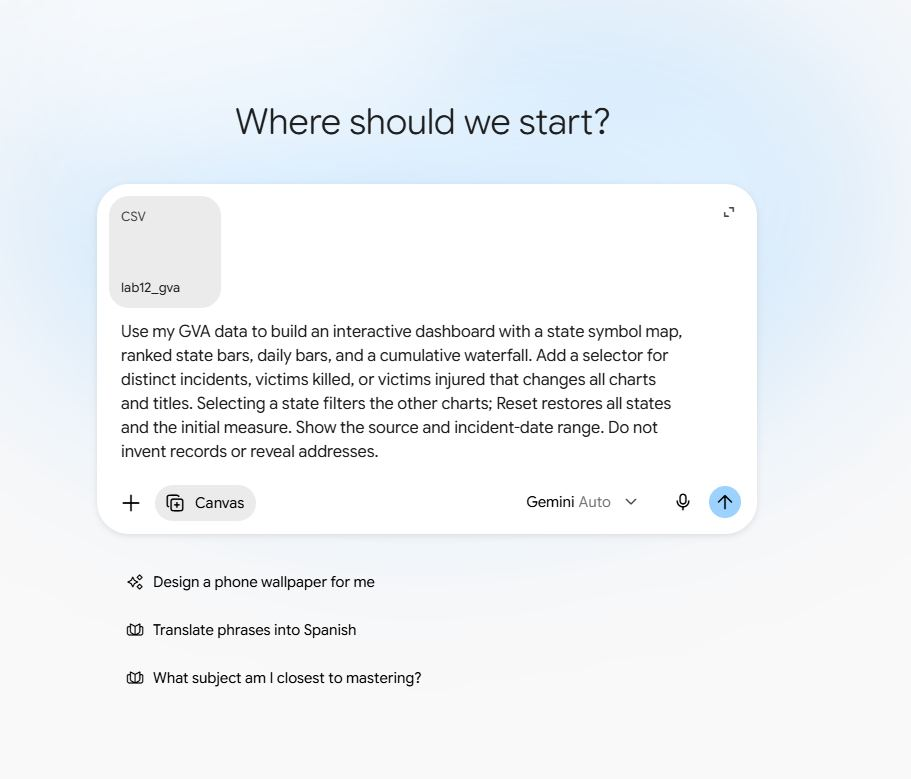

3. Look at the first draft and try the controls. Check whether it shows plausible values and whether labels explain the measures. **A visually attractive chart can still contain an invented value or an unsupported claim.** Gemini does not have to reproduce Tableau's exact chart layout.

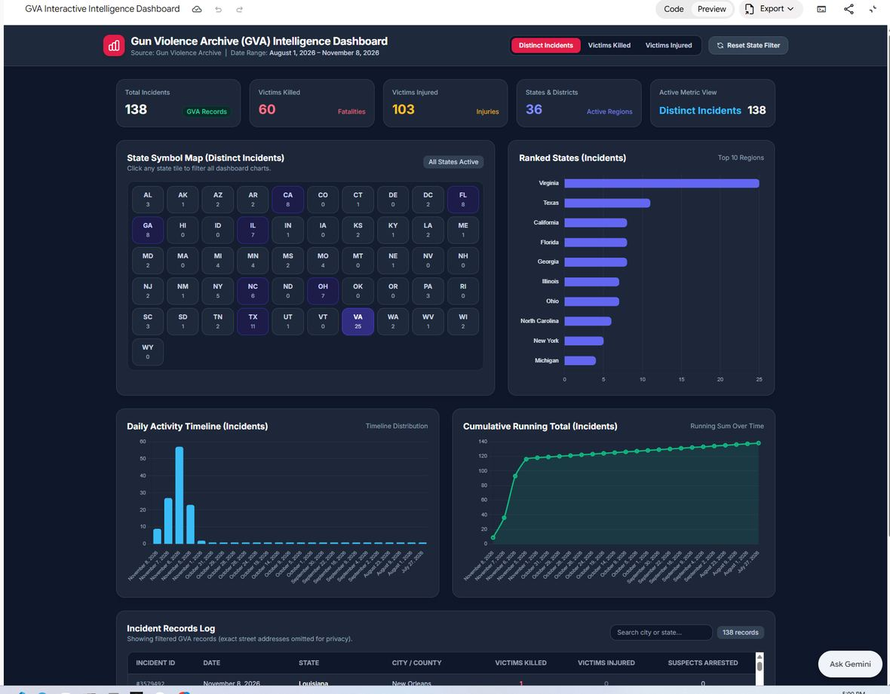

### 12. Experiment with the design

Use your imagination to improve the dashboard through follow-up prompts or **Select & ask**. You decide how many prompts to use and which features to add. Remember the visualization principles from class: **five-second readability, fewer than five views, thoughtful color choices, accurate labels and useful interactions**. This is an opportunity to explore what AI-generated BI does well and where it struggles.

The instructor's examples show both strengths and limitations:

- **Editing a single region:** A Select & ask change can help, but it can also make a map or chart less effective. You can undo it, revise the prompt, or try a different design.

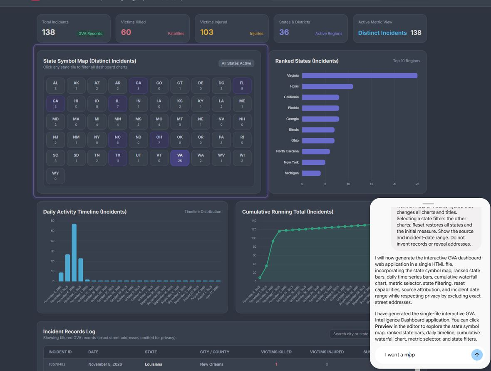

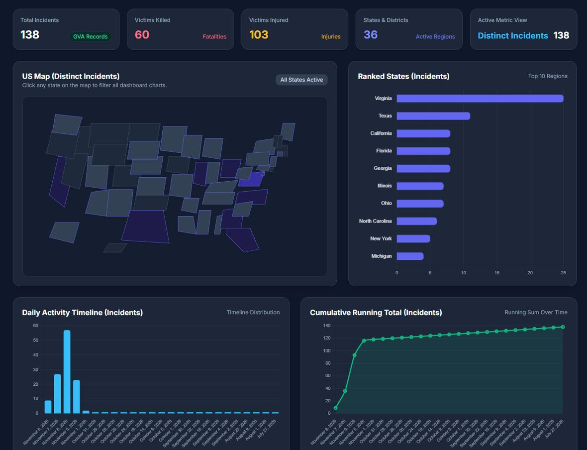

- **Adding functionality:** You may ask for an **Upload New Data** control and see whether the charts update when a different CSV is selected. This demonstrates how flexible the AI-generated interface can be.

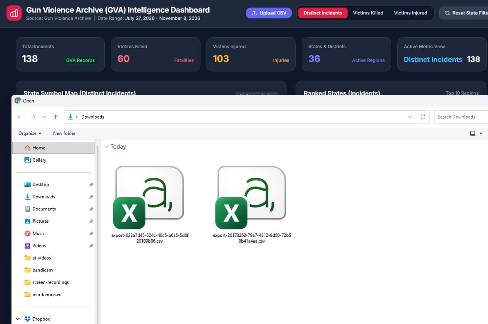

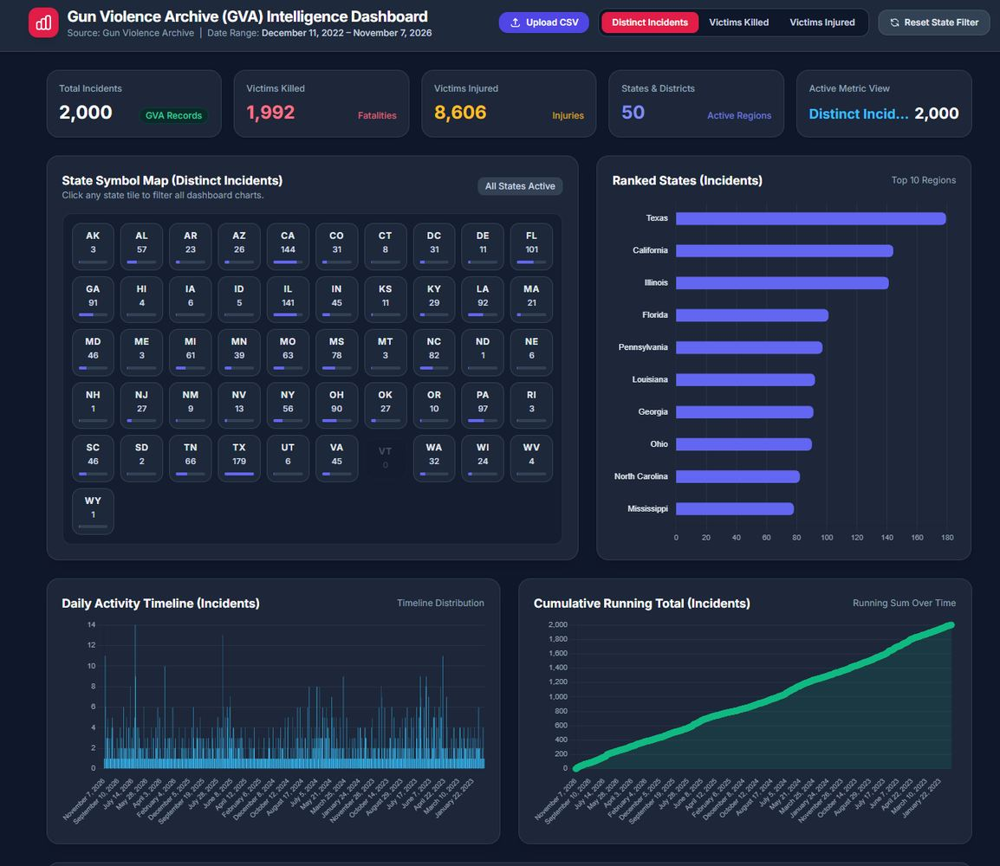

- **Adding AI functionality:** You may experiment with an **AI Summary**. AI-generated descriptions can be helpful, but they may also overinterpret a short dataset. Available AI features depend on your account and app settings.

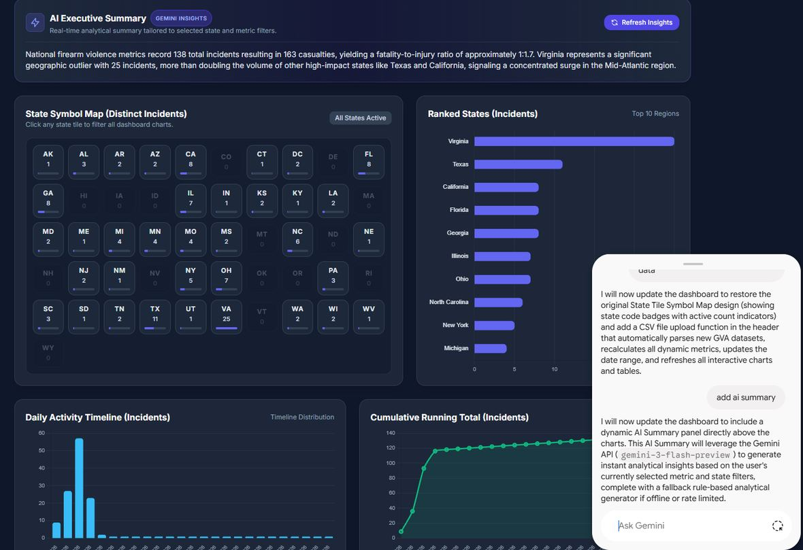

These are **examples, not a list of features you must implement**. The free version's map or SVG rendering may be less polished than Tableau's, but it may be quicker to produce new controls and interactive features. Choose a result you think communicates the data well.

### 13. Share your Canvas app

In the Canvas app choose **Share & export → Share → Copy link**. Submit the **shared app link**, not a Google Sites export. Open the link in a different browser or Google account to ensure the instructor can view your dashboard. The page may request a Google sign-in or show an AI usage notice; it should not require access to your private Google Drive.

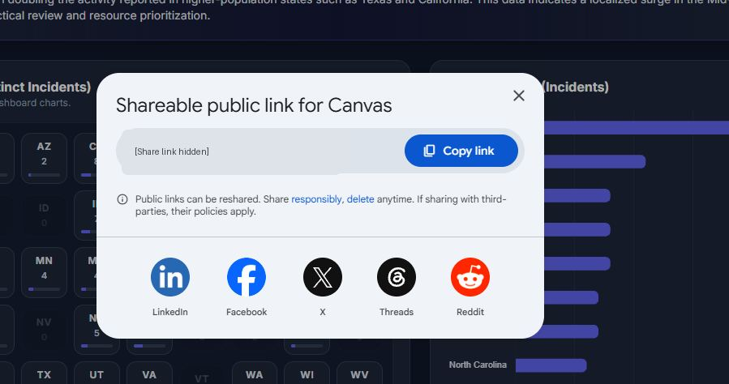

Keep your original CSV private in Drive and do not put addresses, credentials, or private personal information in a publicly shared dashboard.

## Submit in Canvas LMS

In a single **Canvas LMS text entry**, submit **two links and a 2–3 sentence comparison**:

1. **Your Tableau Public Profile URL**, for example `https://public.tableau.com/app/profile/your.username/vizzes`. See the [instructor's profile](https://public.tableau.com/app/profile/xuebin.wei/vizzes) only as a URL-format example. The instructor will find your Lab 12 Workbook and Data Source from your profile (or inspect the Workbook's embedded source).
2. **Your Gemini Canvas shared app link**, accessible to the instructor with a different Google account.
3. **Two or three sentences:** Which version seems **more accurate**—did Gemini invent any data or misleading claims? Which version was **easier or more useful to interact with**, and what did you learn about AI-generated versus manually built BI? Your opinion can favor either platform; **there is no single correct conclusion**.

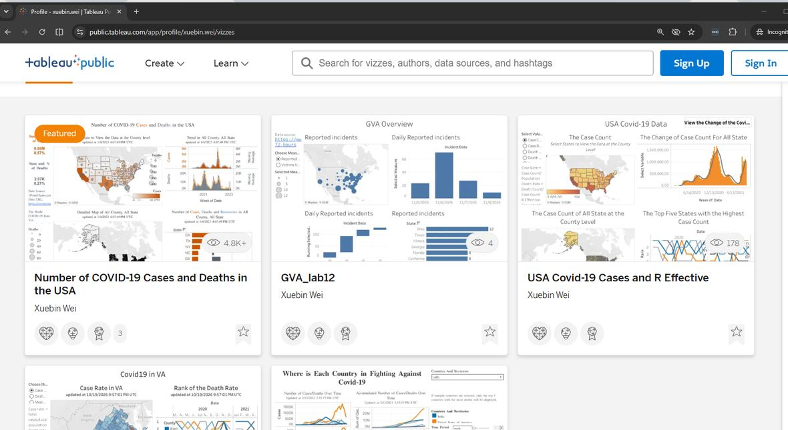

**Access rule:** The Tableau Workbook, its Data Source (standalone or embedded), and the Gemini Canvas app must be accessible to the instructor. An inaccessible component earns zero for that component. You may choose any public username, profile display name and file/project names.

## Rubric — 100 points

| Graded component | Points | Full-credit expectations |
|---|---:|---|
| Tableau Public profile and data preparation | 20 | Personal Public account; GVA CSV connected through own Google Drive; correct field types and Extract; unused fields hidden; usable standalone or embedded Data Source. |
| Tableau Public Dashboard | 30 | Four readable views, correct Choose Measure parameter and calculation, dynamic titles, chronological daily bars and waterfall, working map filter and clear GVA attribution. |
| Gemini Canvas Dashboard | 30 | Accessible shared dashboard using GVA data, meaningful charts (fewer than five views), readable design and useful interactive controls. Creative features are welcome but no specific AI add-on is required. |
| Written comparison | 20 | Both correct links plus a thoughtful 2–3 sentence comparison of accuracy/hallucination risk, ease of use, and AI-generated versus manually built BI; no predetermined opinion. |
| **Total** | **100** | |

## Resources

- [Gun Violence Archive — Last 72 Hours](https://www.gunviolencearchive.org/last-72-hours)
- [Tableau Public — Connect to Data](https://help.tableau.com/current/online/en-us/creator_connect.htm)
- [Tableau — Parameter basics](https://help.tableau.com/current/pro/desktop/en-us/parameters_create.htm)
- [Tableau — Gantt waterfall](https://help.tableau.com/current/pro/desktop/en-us/viewparts_marks_marktypes.htm)
- [Gemini Canvas apps and sharing](https://support.google.com/gemini/answer/16047321?hl=en)
