# Week 8 Lab — Ticket Sales Visualization with Tableau Relationships

**IA342 · Week 8 · October 12 and 14, 2026**

| Item | Requirement |
|---|---|
| Monday | Create and publish a Live **Data Source** with six related tables |
| Wednesday | Create five charts and one **Dashboard** in a Workbook |
| Deadline | **Friday, October 16, 2026, 11:59 p.m. Eastern Time** |
| Submission | Publish your **Data Source and Workbook** in `fall2026`, and submit **one PDF** to Canvas |

**Strongly recommended:** finish the Data Source on Monday and the Dashboard/PDF on Wednesday. The class PostgreSQL database will be stopped after Friday's deadline. Starting again from raw files later is much more tedious.

Name your work `firstname_lastname_week8_tickit_data`, `firstname_lastname_week8_tickit_workbook`, and `firstname_lastname_week8_tickit.pdf`. Substitute your own first and last names.

## Dataset

Use the class PostgreSQL connection: database **`postgres`**, schema **`public`**, username **`demo`**. Find the server address and password in **Canvas**; do not put credentials in your PDF or public files.

- [TICKIT ER diagram](https://dataedo.com/samples/html/Tickit/doc/Tickit_16/modules/Tickit_diagram_136/module.html)
- [AWS TICKIT data download (ZIP)](https://docs.aws.amazon.com/redshift/latest/gsg/samples/tickitdb.zip) · [Table and field definitions](https://docs.aws.amazon.com/redshift/latest/dg/c_sampledb.html)

The full TICKIT database has seven tables, but **this Lab uses six**: `sales`, `listing`, `event`, `category`, `venue`, and `users`. The seventh table, `date`, is not needed.

---

# Monday — Build the Data Source

## 1. Connect to PostgreSQL

In Tableau Cloud, open the **`fall2026`** project → **New → Published Data Source** → **PostgreSQL**. Enter the Canvas connection details and choose `postgres` / `public`.

## 2. Add six separate tables

Drag `sales`, `listing`, `event`, `category`, `venue`, and `users` onto the top-level **Data Source** canvas. Keep them as **separate logical tables** connected by Relationships—not physical joins or a Tableau Flow.

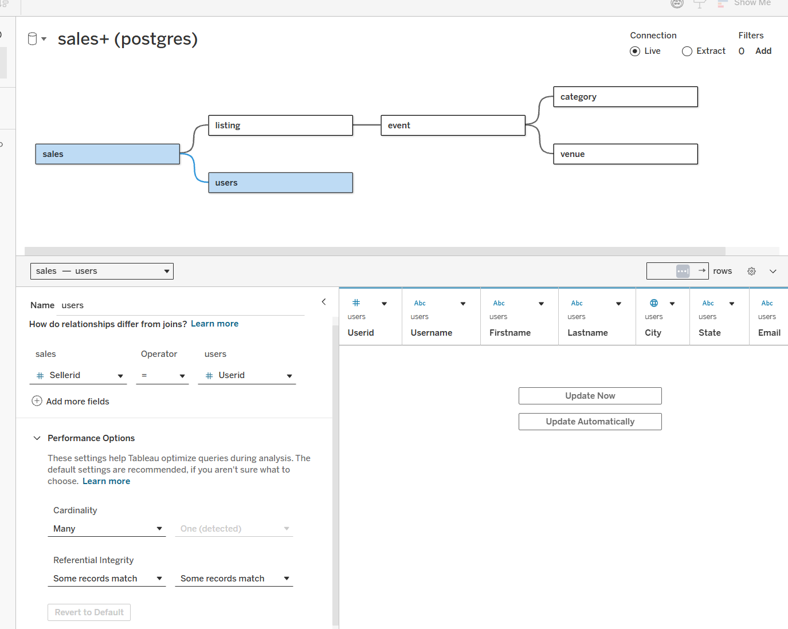

## 3. Define five Relationships

| Relationship fields | Cardinality |
|---|---|
| `sales.listid` = `listing.listid` | Many → One |
| `listing.eventid` = `event.eventid` | Many → One |
| `event.catid` = `category.catid` | Many → One |
| `event.venueid` = `venue.venueid` | Many → One |
| `sales.sellerid` = `users.userid` | Many → One |

Use `sales.sellerid` (seller), **not** `sales.buyerid`. Your canvas should have **six tables and five relationship lines**.

## 4. Set One-to-Many Relationships

For each relationship, set the **Many** side and the **One** side as shown in the table and example screenshot. Keep **Some records match** as the matching setting. 

## 5. Organize the fields

In the Data Source **Scratchpad**, change IDs such as `Salesid` to **Dimensions**. Assign `Venuecity` the geographic role **City** and `Venuestate` **State/Province**. Set monetary fields (`Pricepaid`, `Commission`, `Totalprice`) to **USD ($)**.

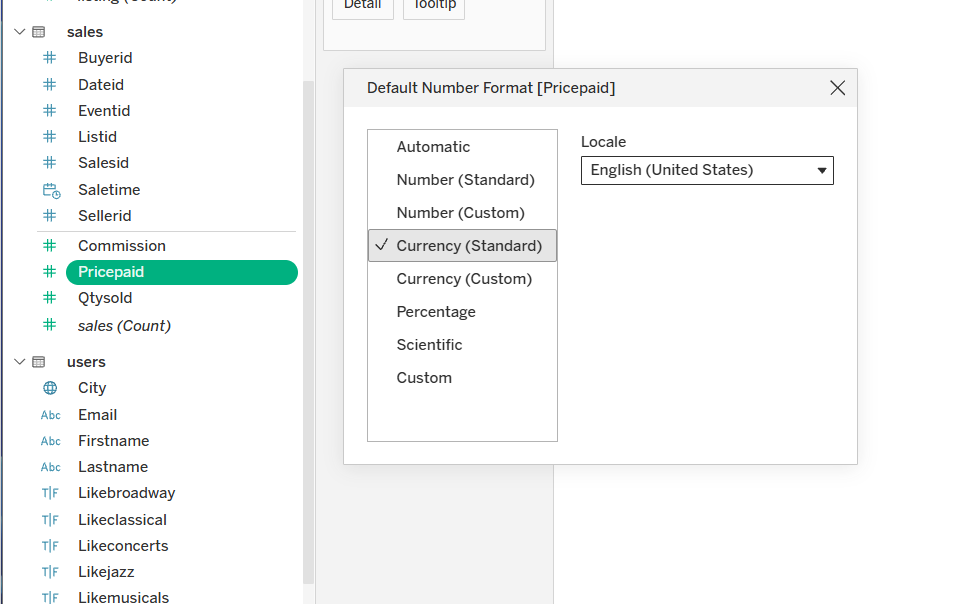

## 6. Create two calculated fields

Use **Create Calculated Field** and enter the exact names (including underscores and capitalization):

**`Seller_Proceeds`** — used in the map:

```tableau
[Pricepaid] - [Commission]
```

**`Realized_Price_per_Ticket`** — used in the Scatter Plot tooltip:

```tableau
IF [Qtysold] > 0 THEN
    [Pricepaid] / [Qtysold]
END
```

Both calculations use fields from `sales`. `Pricepaid` is already the **total amount paid per sale**, so do not multiply it by `Qtysold`.

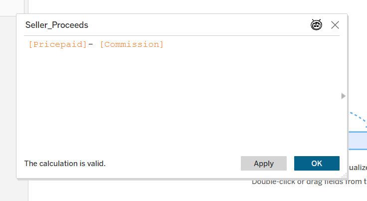

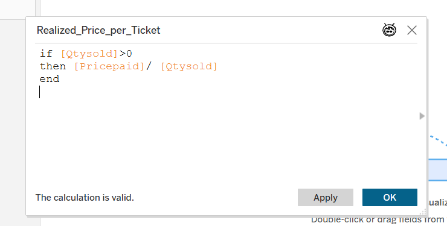

## 7. Create two Hierarchies

- In `category`, **drag `Catname` onto `Catgroup`** to create a hierarchy. Name it **`Category`** (`Catgroup → Catname`).
- In `venue`, **drag `Venuecity` onto `Venuestate`**. Name the hierarchy **`Venue_Location`** (`Venuestate → Venuecity`).

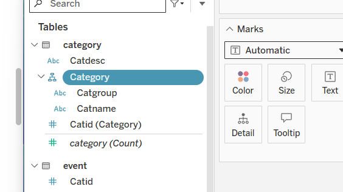

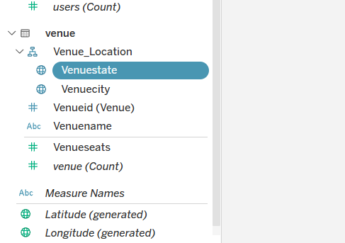

## 8. Quick Data Check

In the Scratchpad, drag fields onto **Marks → Text** to see their results:

- `sales`: drag **`Salesid` → Count** and **`Pricepaid` → Sum** to Text. Expected sales count: **172,456**.
- Clear the Text shelf, then use `listing`: drag **`Listid` → Count** and **`Totalprice` → Sum** to Text. Expected listing count: **192,497**.

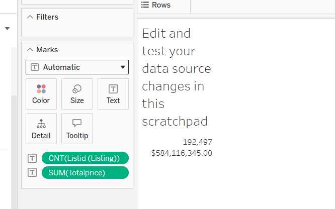

## 9. Publish the Data Source

Select **Live** and publish as **`firstname_lastname_week8_tickit_data`** to **`fall2026`**. In the Publish dialog, **check `Embed credentials`**, so your Workbook can reuse this connection. Confirm the Data Source appears in the course project.

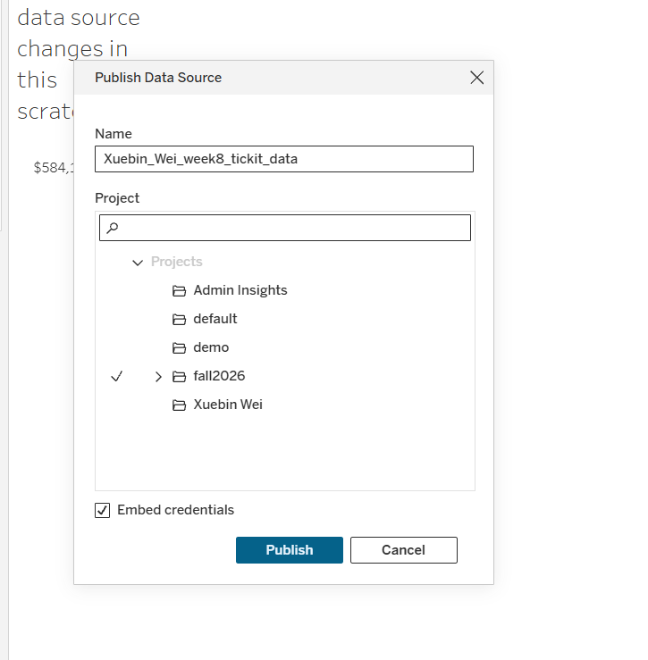

---

# Wednesday — Build the Workbook and Dashboard

**Screenshot note:** Screenshots illustrate Tableau controls. Some show draft chart titles; use the field names and final titles specified in these instructions.

## 10. Open your Workbook

In `fall2026`, open your published Data Source → **New Workbook**. Save as **`firstname_lastname_week8_tickit_workbook`**. Use this Data Source for all five worksheets.

## 11. Chart 1 — Sales Revenue by Category (Bar Chart)

Create **`01_Category_Revenue`**:

1. Drag the **Category** hierarchy to **Rows**, expand it to `Catname`.
2. Drag **`Pricepaid` → SUM** to **Columns**; choose **Bar**.
3. Sort categories by revenue, show the dollar amount on **Label**, and add **Percent of Total** using **Quick Table Calculation**. Format the percent to **one decimal place**.
4. Give the chart the title **Sales Revenue by Event Category**.

**In-class check:** Which event category has the highest total `Pricepaid`?

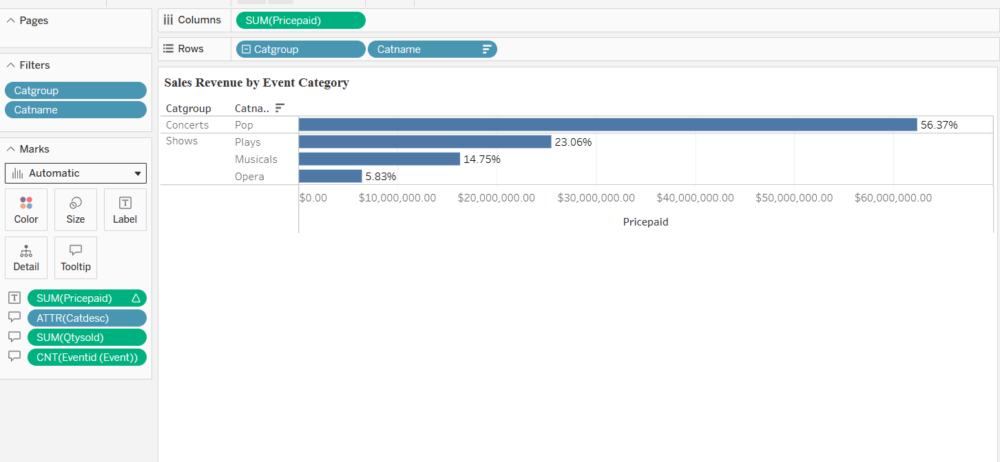

## 12. Chart 2 — Distribution by Listing Total Price (Histogram)

Create **`02_Listing_Price_Distribution`**:

1. In the **`listing`** table, **select `Totalprice` first**, then **Create → Bins**.
2. Name it **`Totalprice (bin)`**. Set **Bin Size = 500**.
3. Put **`Totalprice (bin)`** on **Columns** and **`Salesid` → COUNT** on **Rows**. Choose **Bar**.
4. Try bin sizes **250**, **500**, and **1,000**; return to **500** for the final chart.
5. Title it **Sales Transactions by Listing Value — USD 500 Bins**.

The bars count sales transactions associated with listings in each dollar-value bin.

**In-class check:** Which $500 listing-value bin contains the most `Salesid` records?

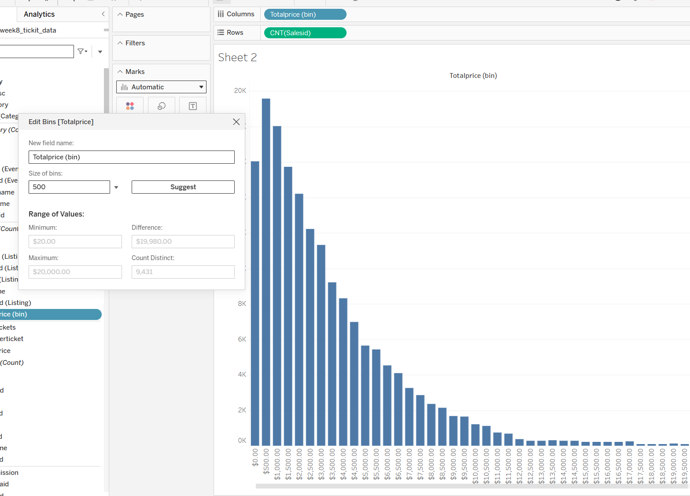

## 13. Chart 2 — Add Running Total, Percentage, and a Line

Stay in **`02_Listing_Price_Distribution`**:

1. Copy **`CNT(Salesid)`** to **Rows** again. You will see **two charts**, one above the other.
2. On the **second** `CNT(Salesid)` pill, choose **Quick Table Calculation → Running Total**.
3. On that same second pill, open **Edit Table Calculation**, check **Add secondary calculation**, and choose **Percent of Total**. Set **Compute Using → Table (Across)** for both.
4. On the Marks cards, keep the **first chart = Bar** and change the **second chart = Line**.
5. On the second measure pill, choose **Dual Axis** to combine the charts. Keep the **left axis as the number of sales** and the **right axis as a percentage**.
6. Set **Bar = blue** and **Line = yellow**. The line should rise toward **100%** across the bins.

The two axes use different units (count and percentage), so **do not synchronize their numeric scales**.

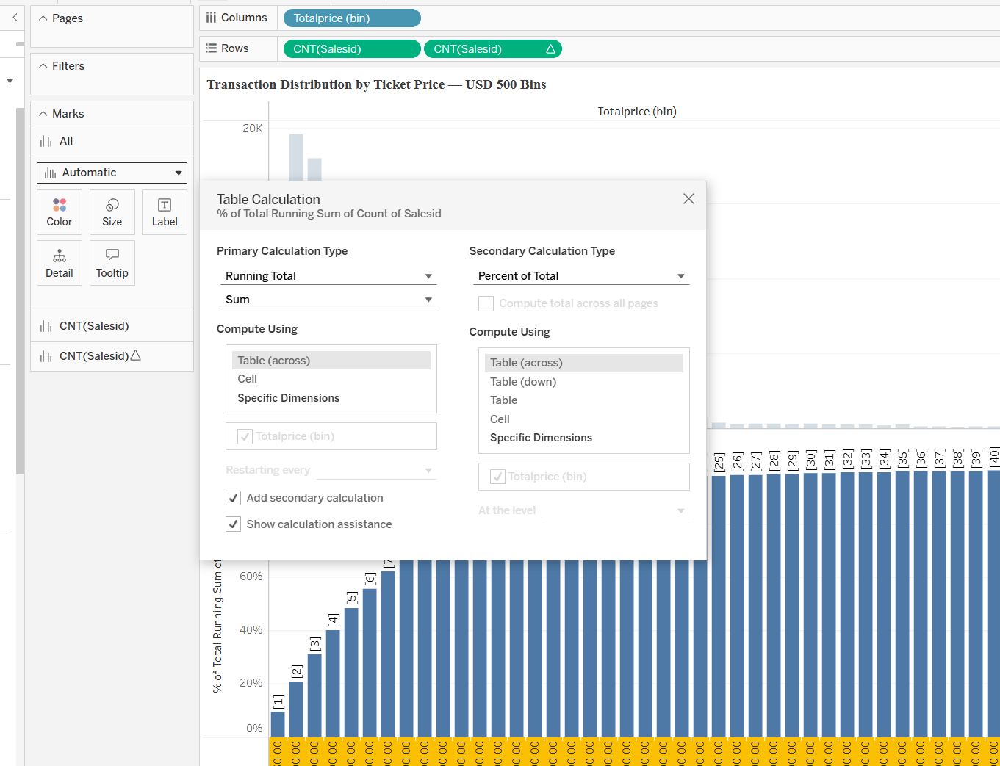

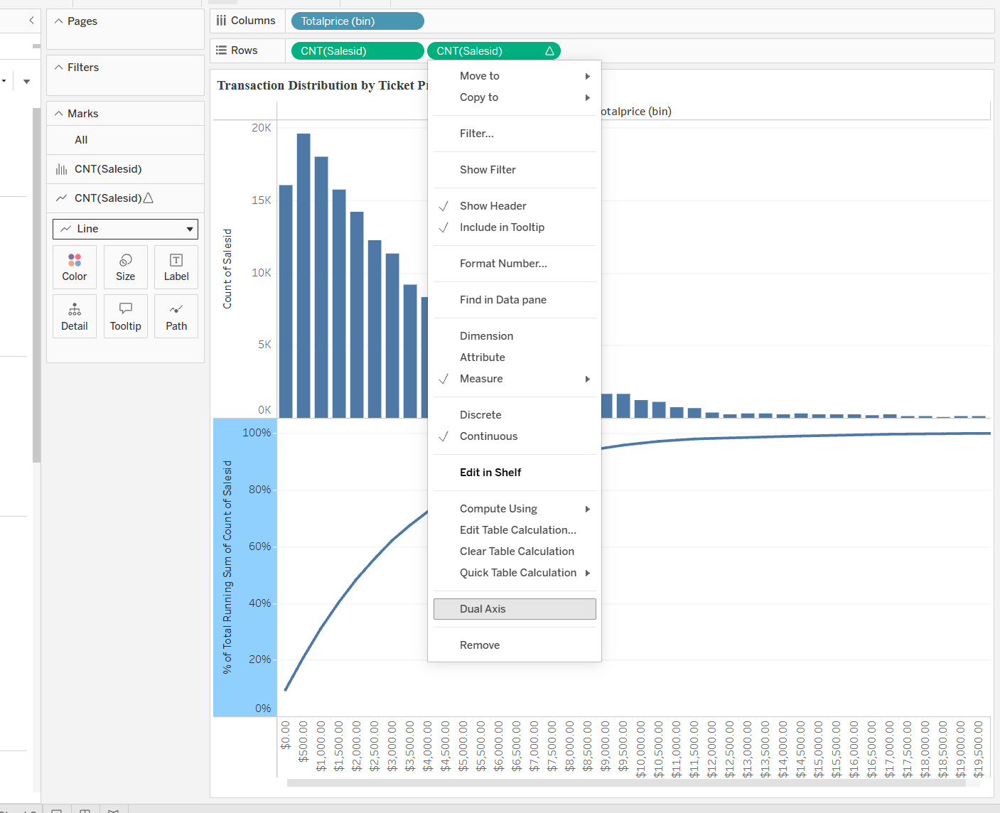

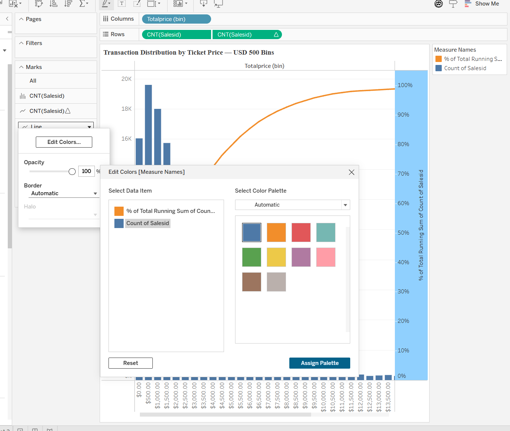

## 14. Chart 3 — Average Listing vs. Sale Amount (Scatter Plot)

Create **`03_Venue_Amount_Comparison`**:

1. Put **`AVG(Totalprice)`** on **Columns** and **`AVG(Pricepaid)`** on **Rows**.
2. Put **`Venueid`** on **Detail** and **`Catname`** on **Color**. Choose **Circle** marks.
3. Add **`AVG(Realized_Price_per_Ticket)`** and venue details to the **Tooltip**.
4. From **Analytics**, add a **Linear Trend Line**.
5. Try changing the axis range/scale, then return to **linear axes**. Right-click an interesting high-value dot → **Annotate → Mark**.
6. Title: **Average Listing Amount vs. Average Sale Amount by Venue and Category**.

**In-class check:** Which venue has the highest average sale amount in this chart?

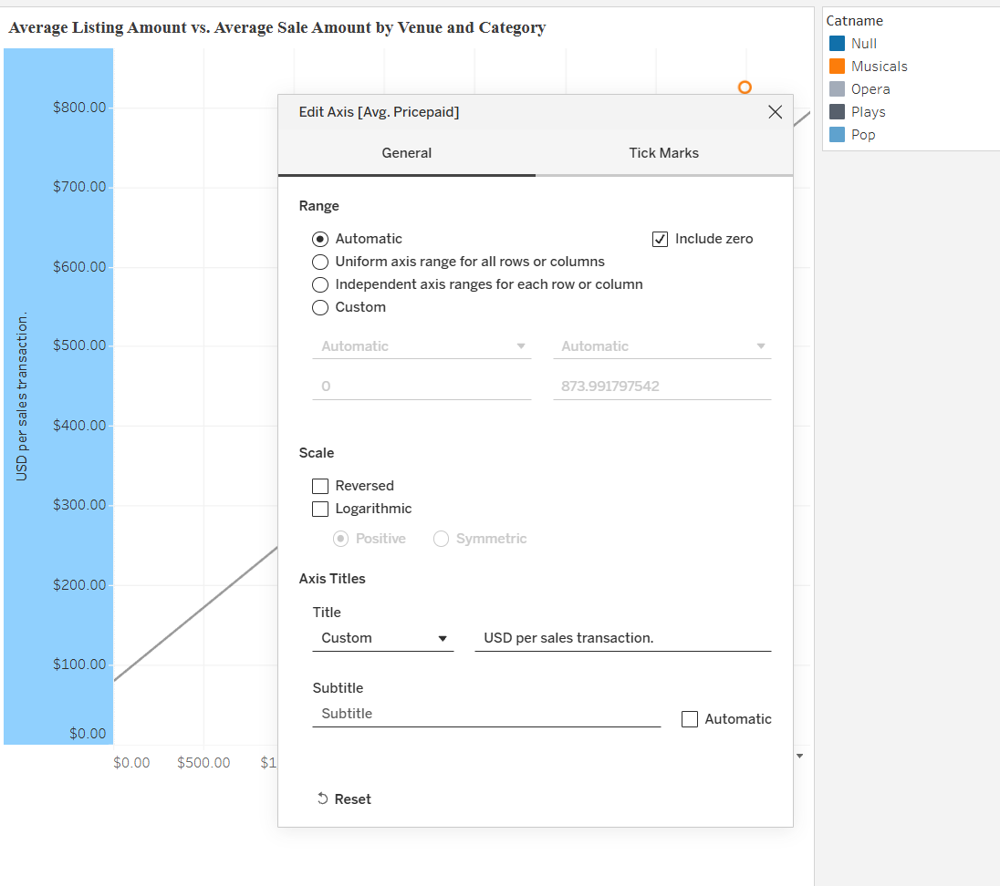

## 15. Chart 4 — Sales vs. Listings by Seller (Bullet Graph)

Create **`04_Sales_vs_Listings_by_Seller`**:

1. Select **`users.Lastname`**, **`listing.Totalprice`**, and **`sales.Pricepaid`** together.
2. Choose **Show Me → Bullet Graph**.
3. Check that the **bar represents `SUM(Pricepaid)`** and the reference marker shows **`SUM(Totalprice)`**.
4. Sort the sellers by **`SUM(Pricepaid)`**, highest first.
5. Drag **`Lastname` → Filters → Top/Bottom → Top 10 by `SUM(Totalprice)`**.
6. Title: **Sales Revenue vs. Total Listing Value by Seller**.

**In-class check:** Among the displayed Top 10 seller last names, which has the highest total `Pricepaid`?

**Note:** One last name may represent more than one person. Listing value and sales revenue describe different totals; this chart is a comparison, not profit.

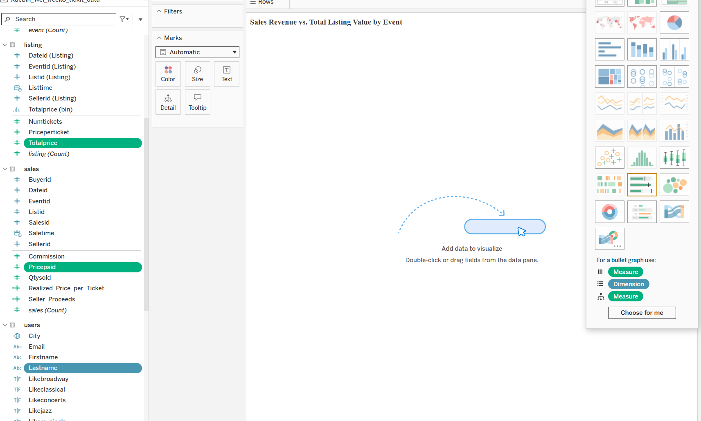

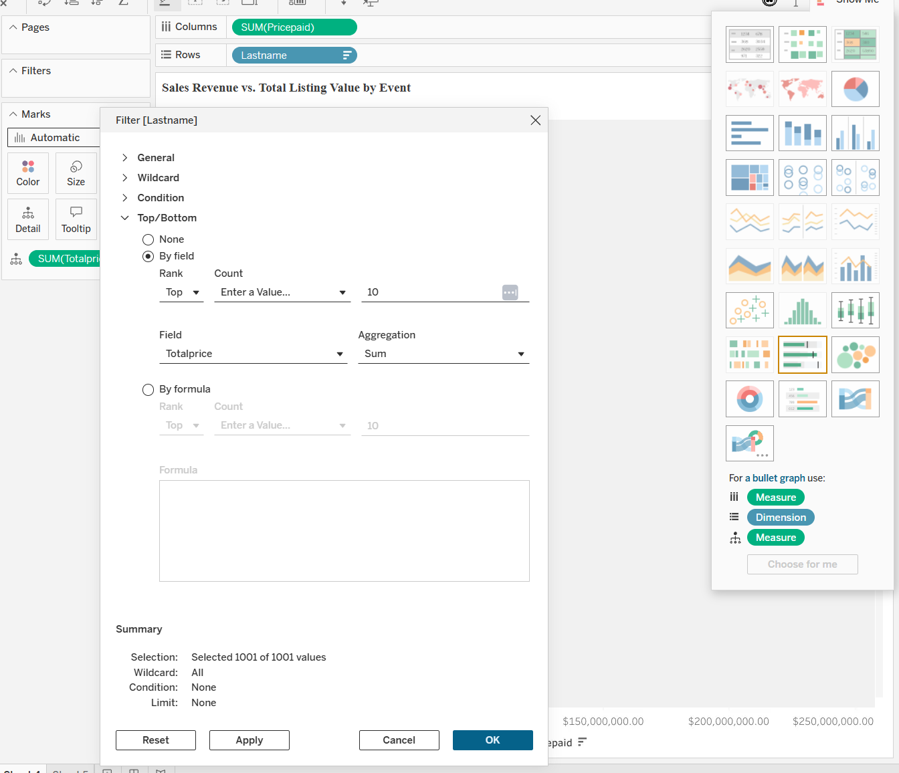

## 16. Chart 5 — Seller Proceeds by City (Symbol Map)

Create **`05_Proceeds_by_Venue_City`**:

1. Select **`Venuecity`** and **`Seller_Proceeds`**.
2. Choose **Show Me → Symbol Map**.
3. Put **`SUM(Seller_Proceeds)`** on **Size**, keep **`Venuestate`** on **Detail** for location context, and show the city/proceeds in the Tooltip.
4. Title: **Seller Proceeds by Event Venue City**.

**In-class check:** Which venue city has the highest total `Seller_Proceeds`?

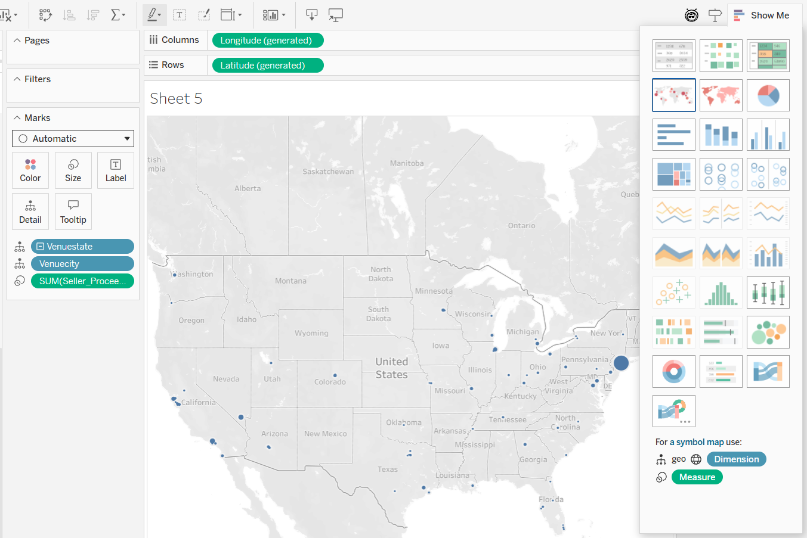

## 17. Build the Dashboard

Create **`Ticket Sales Dashboard`** and place the five worksheets as shown:

| Location | Chart |
|---|---|
| Top left | Category Revenue |
| Top right | Histogram + cumulative line |
| **Middle left** | **Seller Bullet Graph** |
| **Middle right** | **Venue Scatter Plot** |
| Bottom | Symbol Map |

Keep each chart's **legend close to that chart**. Add a simple **Username filter** and try selecting a seller to see which event cities appear on the map. Use the chart's **Use as Filter** option if you want the Bullet Graph to filter the other views. Return to the complete Dashboard view before exporting.

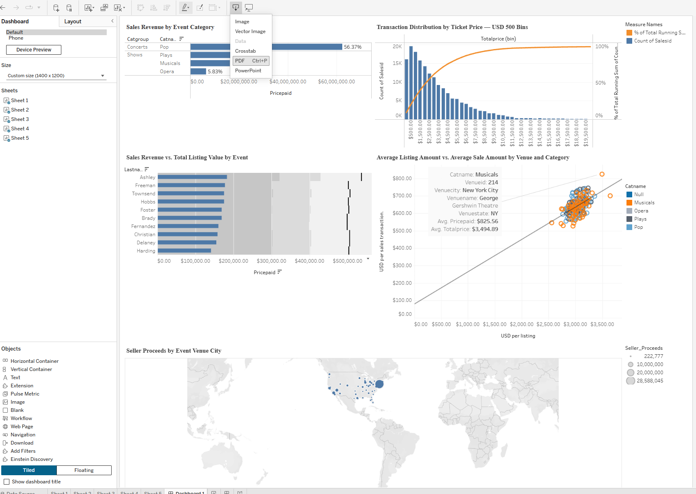

## 18. Publish and Submit

1. **Publish** the Workbook in `fall2026` with all **five Worksheets and one Dashboard**.
2. From the Dashboard choose **Download → PDF**. Check that the five charts, labels, and legends are readable.
3. Submit **one PDF** to the Week 8 assignment in **Canvas**. No written answers to the in-class questions are required.

**Final deliverables:** **Published Data Source + Published Workbook + one PDF**. The instructor checks the Tableau items separately; only the PDF is uploaded to Canvas.

## Grading — 100 points

| Item | Points | Main requirement |
|---|---:|---|
| **Published Data Source** | **35** | Six tables, five Relationships, fields, hierarchies, and calculated fields |
| **Published Workbook** | **15** | Five worksheets, one Dashboard, uses your published Data Source |
| **PDF report** | **50** | Readable final Dashboard and accurate charts, labels, and comparisons |
| **Total** | **100** | Data Source + Workbook + PDF |

The instructor may award partial credit when work is incomplete or inaccurate.

## If the Class Database Is No Longer Available

The course PostgreSQL database will be stopped after **Friday, October 16, 2026, at 11:59 p.m. Eastern Time**. Because the classroom Data Source uses a **Live** connection, it cannot query the stopped database.

If you have not finished, you must download the [AWS TICKIT data ZIP](https://docs.aws.amazon.com/redshift/latest/gsg/samples/tickitdb.zip) and create a replacement Data Source from the original files yourself. **Tableau Cloud accepts the TXT files directly**; Excel conversion and Tableau Flow are not needed.

| File | Original table | Delimiter |
|---|---|---|
| `sales_tab.txt` | `sales` | Tab |
| `listings_pipe.txt` | `listing` | Pipe (`\|`) |
| `allevents_pipe.txt` | `event` | Pipe (`\|`) |
| `category_pipe.txt` | `category` | Pipe (`\|`) |
| `venue_pipe.txt` | `venue` | Pipe (`\|`) |
| `allusers_pipe.txt` | `users` | Pipe (`\|`) |

The seventh file, `date2008_pipe.txt`, is not needed for this lab.

These files **do not have column headers**. After uploading them as separate tables in **one Data Source**, set the correct Tab/pipe delimiters and rename the imported columns **in their original order**, using the [AWS field definitions](https://docs.aws.amazon.com/redshift/latest/dg/c_sampledb.html). Then set field types, rebuild the five Relationships, create the calculated fields/hierarchies, reconnect your Workbook, and export/submit your PDF. This extra work is your responsibility.

The usual syllabus late penalty applies: **10% per day, up to 40%**, unless the instructor has approved an exception. The database will not be restarted solely for late submissions.

---

[Return to Course Home](../../) | [Return to Syllabus](../../syllabus/)
