# Lab 9. Visual Analytics in Tableau

**IA342 · Dr. Wei**

## Objectives

Use Tableau's visual analytics functions to change the level of detail, compare values, select subsets, and inspect related information. You will build four worksheets: a weekly line chart, a county map, a state/county bar chart, and a state-level scatter plot.

The exercises combine **dimensions and measures**, **date levels**, **parameters**, **sets and set actions**, **filters**, **reference lines**, and **tooltips**.

## Data

The COVID-19 data was originally downloaded from [1Point3Acres](https://coronavirus.1point3acres.com/). A copy of the historical dataset is available on **Canvas**. Use that course file in Tableau Online.

The steps use the course exercise's `SUM(Confirmed Count)` and `SUM(Death Count)` aggregations. Interpret the counts using the definition supplied with the Canvas file: **daily increments can be summed over time; cumulative snapshots cannot**.

## Steps

Complete all steps unless they are marked **Optional**.

### 1. Upload the COVID-19 data

Download the data from Canvas. In **Explore → fall2026**, choose **New → Published Data Source → Files**, then upload the COVID file.

Publish the COVID Data Source once, then use it for all four worksheets in the COVID Workbook.


### 2. Set field roles and data types

In the Scratchpad, move **FIPS** to Dimensions. Check the other fields before building charts:

| Field | Type / role | Use in this Lab |
|---|---|---|
| Confirmed Date | Date / dimension | Group records by week |
| State Name | Dimension; State/Province geographic role | Group by state; provide geographic context |
| County Name | Dimension; County geographic role | Group by county within a state |
| FIPS | Identifier / dimension | Distinguish county records in the map |
| Confirmed Count | Numeric measure | Aggregate the confirmed-count field |
| Death Count | Numeric measure | Aggregate the death-count field |

**A field can contain numbers and still be a dimension.** FIPS identifies places; adding FIPS values does not give a meaningful count. Keep the supplied identifier intact, including any leading zeros. A geographic role tells Tableau how to interpret a place field; it is separate from the field's data type.


### 3. Add Data Source filters

Open the Data Source and add these two filters, keeping values **at least 0**:

```text
Confirmed Count >= 0
Death Count >= 0
```

Apply both as **record-level Data Source filters**, not filters on worksheet totals. All four worksheets will use this same subset.

Negative counts may represent reporting corrections; they are excluded from this exercise's working subset.


### 4. Create an extract

Choose an **Extract** connection and create the extract. If Tableau has already created an extract for the uploaded file, use it.

The extract stores a copy of the uploaded data for analysis.


### 5. Publish the Data Source

Publish in **`fall2026`** as:

```text
firstname_lastname_week9_covid_data
```


### 6. Create a new Workbook

Select your published COVID Data Source and create a **New Workbook**. Use **Sheet 1–4** for the four charts below. Save as you complete each section.

| Worksheet | Grouping level | Main interaction |
|---|---|---|
| Sheet 1 — Line chart | Week | A parameter changes weekly color categories |
| Sheet 2 — Map | County, identified by FIPS | Selection changes county-set membership |
| Sheet 3 — Bars | State → County | Hierarchy, sorting, filters, and a weekly tooltip |
| Sheet 4 — Scatter plot | State | The shared parameter moves a reference line |

### 7. Create a weekly line chart

In **Sheet 1**, create the following view:

| Location | Field / setting |
|---|---|
| Columns | WEEK(Confirmed Date) — **Continuous (green)**, retaining the year |
| Rows | SUM(Confirmed Count) |
| Marks | Line |

Keep State Name, County Name, and FIPS out of Detail for this initial view. Records in the same week are summarized into one weekly value.

**7.1. Optional — Explore Discrete vs. Continuous.** Try switching the Week field between **Discrete (blue)** and **Continuous (green)**. You may also explore Year, Quarter, and Month.

**Required final view:** use **Continuous WEEK(Confirmed Date)** with the **Line** mark type. Keep the full weekly dates, including the year, in chronological order—not week numbers pooled across years.

**7.2. Add an average-cases reference line.** Add a reference line for the **average of the plotted weekly SUM(Confirmed Count) values**. Set the scope to **Entire Table**, choose **Average**, and keep its label visible. **This reference line is required.**

**7.3. Optional — Explore color encodings.** Try a continuous measure on Color and compare its numeric legend with discrete category colors. For the final chart, use the **high/low categories** created below.

**7.4. Use a parameter to control the categories.**

**7.4.1.** Create a calculated field named **`case class`**:

```tableau
IF SUM([Confirmed Count]) > 1000000 THEN
    'high'
ELSE
    'low'
END
```

The `SUM` is evaluated at the view's grouping level—here, one week. Using `[Confirmed Count]` without the aggregation would test each underlying row instead.

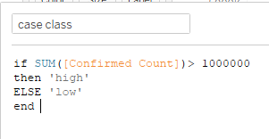

**7.4.2.** Create an **Integer** parameter named **`case level`**. Begin with **1,000,000**. Use a **Range** from **0** to **1,000,000**, step size **100,000**, and show its control.

Increase the maximum if needed to move the threshold above and below observed values, including the state totals in Sheet 4.

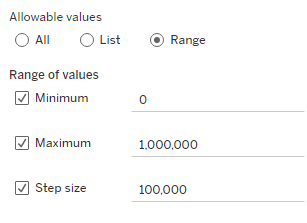

**7.4.3.** Replace the fixed number in `case class` with the parameter:

```tableau
IF SUM([Confirmed Count]) > [case level] THEN
    'high'
ELSE
    'low'
END
```

The parameter supplies the threshold; the calculation assigns each weekly total to high or low.

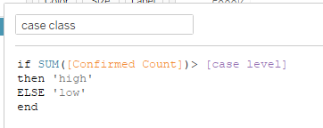

**7.4.4.** Put **`case class` on Color** and keep the parameter control visible. Edit the colors so **high uses orange or another warm color**, and **low uses blue or another cool color**. These color assignments are required.

Change `case level` below and above an observed weekly total to check the classification. A value exactly equal to the threshold belongs to **low**, because the calculation uses **`>`**.

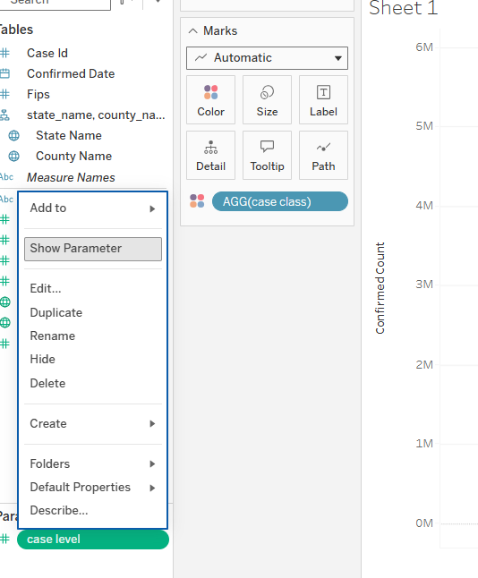

**Check:** the final chart has a continuous weekly axis, a labeled Average reference line, warm high values, and cool low values. Changing the parameter changes categories—not case counts. Keep `case class` off Filters.


### 8. Create a county map

In **Sheet 2**, build a filled county map. Use **United States** as the country context and keep **State Name** with **County Name**. Put **SUM(Confirmed Count)** on Color.

**8.1. Set the numeric color scale.** Use a **diverging palette** with **higher values in orange/warm colors** and **lower values in blue/cool colors**, and show the legend. The map displays counts, not population-adjusted rates.

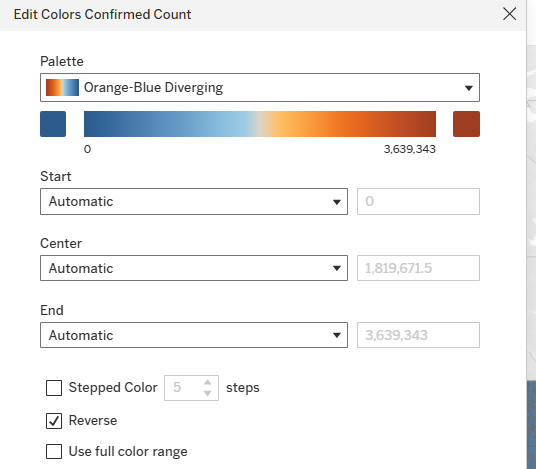

**8.2.** Put **FIPS on Detail**. State Name disambiguates county names that occur in multiple states; FIPS provides a county identifier. Leave the date off Detail so dates are not separate marks within a county.

**8.3.** Inspect unknown locations. Any exclusions used to complete this map should be limited to this worksheet. Changing a Data Source filter would also affect the other three views.

**8.4.** Create a set based on **FIPS** named **`selected counties`**. Initially select all available members, so the map starts with all county values shown.

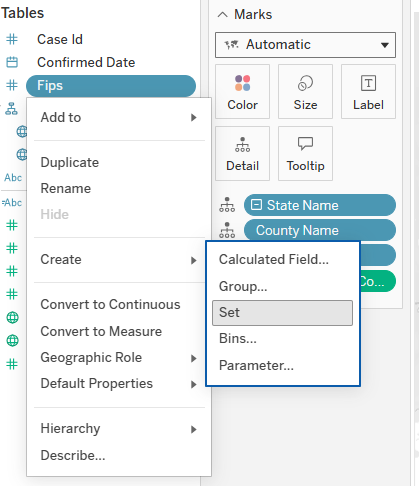

**8.5.** Create **`selected cases`**:

```tableau
IF [selected counties] THEN
    [Confirmed Count]
END
```

Replace the color field with **SUM(selected cases)**. Keep the original **SUM(Confirmed Count)** in the tooltip with State Name, County Name, and FIPS.

For a member **IN** the set, the calculation returns the count. For a member **OUT**, it returns **null**. Null means no selected value; it does not mean zero cases. Keep the set off Filters, and retain unselected geography as context.

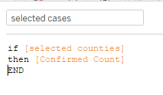

**8.6.** Open **Worksheet → Actions → Add Action → Change Set Values**.

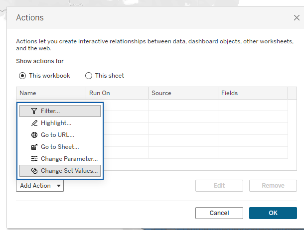

**8.7.** Name the action **`show colors`** and configure it:

| Setting | Value |
|---|---|
| Source sheet | Sheet 2 |
| Run action on | Select |
| Single-select only | Off |
| Target set | selected counties, in the COVID Data Source |
| Running the action | Assign values to set |
| Clearing the selection | Add all values to set |

**Assign** replaces the set membership with the selection; **Add all on clear** restores all counties.

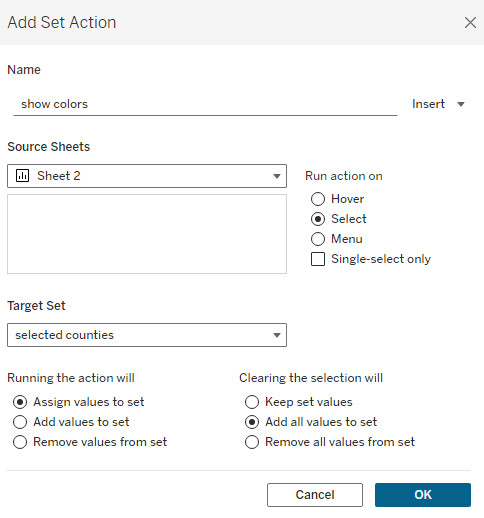

**8.8.** Select several counties, inspect the colors and legend, then clear the selection. Keep the numeric color endpoints automatic while testing how the selected range affects color contrast.

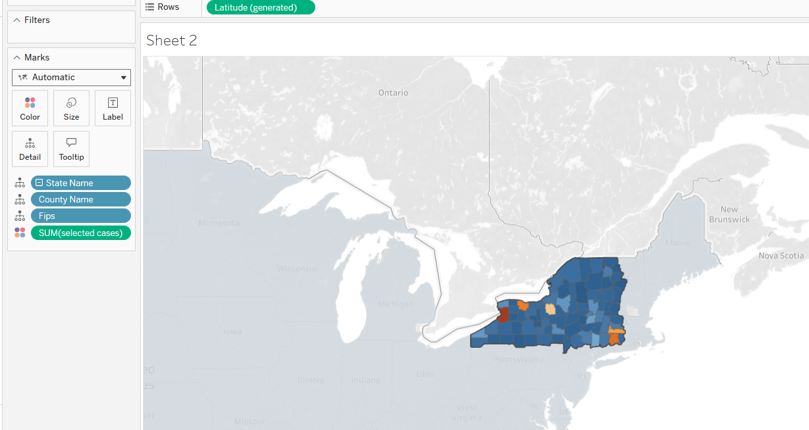

**Check:** selecting counties updates the set-based colors; clearing the selection restores all counties. Unselected counties are not treated as zero cases.

### 9. Create a state/county bar chart

In **Sheet 3**, create two measure panes:

| Location | Field / setting |
|---|---|
| Rows | State Name, then County Name for county detail |
| Columns | SUM(Confirmed Count), SUM(Death Count) |
| Marks | Bar |

Create a **State Name → County Name** hierarchy to compare the collapsed state summaries with expanded county rows. The displayed groups change; expanding the hierarchy is not a filter.

The two measure panes can have different axis ranges. A similar bar length across the panes does not imply equal numerical values—read the axes.

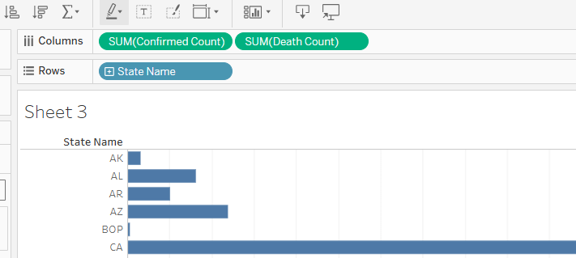

**9.1. Sort the bars.** Use a **descending nested sort by SUM(Confirmed Count)** so counties are ranked within each state. **Optional:** try a field sort for comparison, then restore the nested sort.

**9.2.** Add **State Name** and **County Name** to Filters and show both controls. Keep these filters scoped to Sheet 3 unless a step explicitly requires another scope.

**9.3.** Set the County Name filter to **Only Relevant Values**, so county choices follow the selected state. **Optional:** compare this with **All Values in Database**, then restore Only Relevant Values.

When switching states, a previously selected county may no longer match. Clear the county filter first rather than treating the resulting blank chart as missing data.

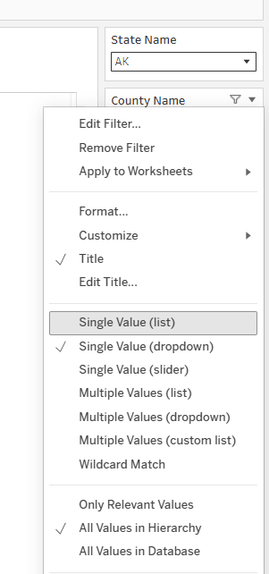

**9.4. Add a Viz in Tooltip.** Sheet 3 is the **source view**; Sheet 1 is the **target view**.

1. Open **Marks → Tooltip** and insert fields for State Name, County Name, and the count measures.
2. Use **Insert → Sheets → Sheet 1** to insert the weekly view. Use the demonstrated editor if the web menu differs.
3. Retain **All Fields** filtering in the inserted sheet tag. State Name and County Name must be available in the source mark so the target can be filtered to that place.
4. Use a readable size, such as **500 × 300**. Inspect the displayed chart for clipping. The tooltip shows a filtered image of Sheet 1, not an independently interactive sheet.
5. Apply the tooltip to both measure panes through the **All** Marks card, or edit both panes if they have separate tooltip settings.

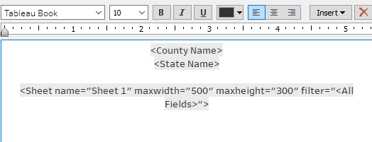

**9.5.** Hover over two county bars. Each tooltip should show that county's weekly series. The chart should not repeat the same all-county series on every bar.

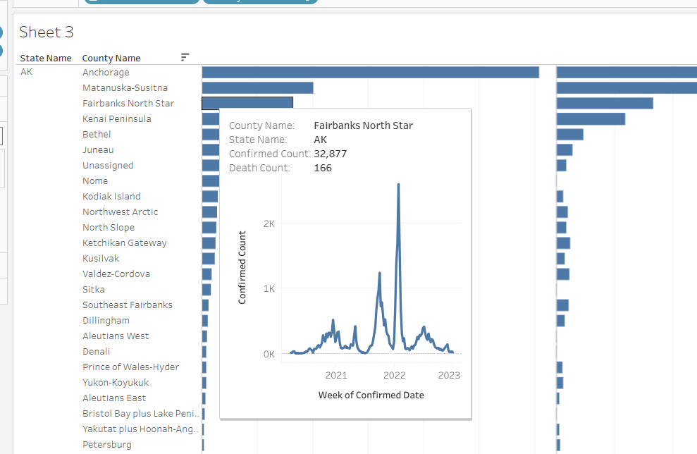

**Check:** the tooltip works on both measure panes and shows the weekly series for the hovered county.

### 10. Create a state-level scatter plot

In **Sheet 4**, create this view:

| Location | Field / setting |
|---|---|
| Columns | SUM(Confirmed Count) |
| Rows | SUM(Death Count) |
| Detail | State Name |
| Marks | Circle |
| Tooltip | State Name and both aggregated measures |

With no grouping dimension, the measures collapse into one overall pair. **State Name on Detail** separates state pairs. Keep County Name, FIPS, and Confirmed Date off Detail so the plot stays at state level.

**10.1. Optional — Explore Data Guide.** Where available, select a state and inspect its fields, filters, or explanations. This exploration is not graded.

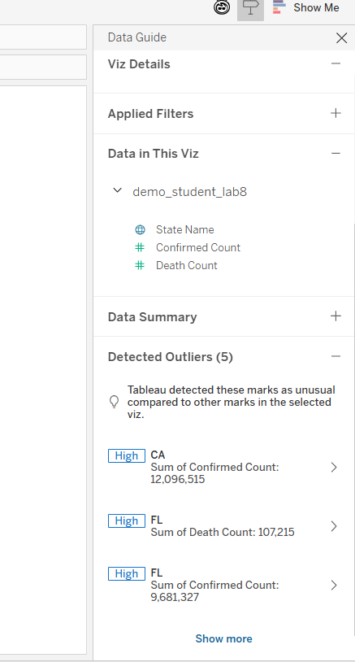

**10.2.** Add a reference line to the **Confirmed Count axis** and choose the existing **`case level`** parameter as its value. This creates a **vertical** reference line because Confirmed Count is on Columns.

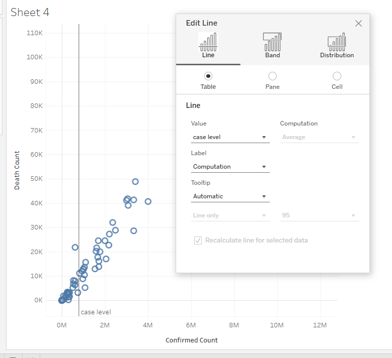

**10.3.** Show the parameter control and change its value. The reference line moves, but the scatter coordinates stay fixed. Return to Sheet 1: the same parameter also changes its weekly color categories.

Use the **same `case level` parameter** in Sheets 1 and 4.

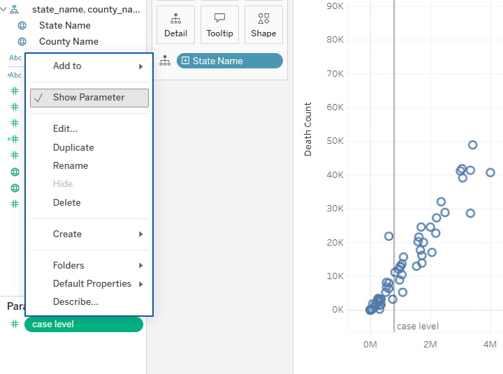

**Check:** there is one mark per state, and changing `case level` moves the vertical reference line without moving the marks.

### 11. Publish the Workbook

Publish in **`fall2026`** as:

```text
firstname_lastname_week9_covid
```

Show the worksheet tabs and reopen the **published Workbook in viewing mode**. Confirm that all four charts open, the Workbook uses your published COVID Data Source, and the parameters, filters, set action, and tooltip work.

Keep these worksheets and the Data Source for reuse in the dashboard activity.

## Submission

Publish these **three items** in **`fall2026`** before the Week 9 deadline shown in Canvas:

| Session | Item | Name |
|---|---|---|
| Monday | Diamonds lecture Workbook | `firstname_lastname_week9_diamonds` |
| Wednesday | COVID Data Source | `firstname_lastname_week9_covid_data` |
| Wednesday | COVID Workbook | `firstname_lastname_week9_covid` |

The Monday Workbook uses your **existing Lab 5 Diamonds Data Source**; do not publish another Diamonds Data Source. Keep the original Lab 5 Workbook unchanged.

The final submission time is determined by the last modified time of the required work in Tableau Online. Late penalties apply according to the course syllabus.

## Grading rubric — 100 points

| Item | Points | Requirements |
|---|---:|---|
| Monday Diamonds Workbook | 20 | Class exercises saved in the new Workbook using the existing Lab 5 Diamonds Data Source. |
| COVID Data Source | 20 | Correct field types and roles, both Data Source filters, an extract, and publication in `fall2026`. |
| Sheet 1 — Weekly line chart | 15 | Continuous weekly dates; Average reference line; working `case level` and `case class`; high = warm/orange, low = cool/blue. |
| Sheet 2 — County map | 15 | County detail with FIPS; `selected counties` and `selected cases`; working Set Action that restores all counties when cleared. |
| Sheet 3 — State/county bars | 15 | Both count measures; hierarchy and descending nested sort; relevant-value filters; working weekly Viz in Tooltip. |
| Sheet 4 — State scatter plot | 15 | Correct measures and state-level marks; a vertical reference line controlled by the shared `case level` parameter. |
| **Total** | **100** | |

Points are deducted for missing or incorrect required elements. Optional exploration is not graded.

<p class="help-links">Tableau Help: <a href="https://help.tableau.com/current/pro/desktop/en-us/datafields_typesandroles.htm">Fields</a> · <a href="https://help.tableau.com/current/pro/desktop/en-us/dates_levels.htm">Date levels</a> · <a href="https://help.tableau.com/current/pro/desktop/en-us/actions_sets.htm">Set actions</a> · <a href="https://help.tableau.com/current/pro/desktop/en-us/viz_in_tooltip.htm">Viz in Tooltip</a></p>
