<link rel="stylesheet" href="assets/slide-deck.css">

  <h1>IA342 · Week 10 — Dashboard Design</h1>
  
<strong>Dr. Xuebin Wei</strong> · October 26–30, 2026 · <a href="../../assignments/lab-10/">Lab 10 instructions</a>

  

    IA342 · Dashboard Design
    

      <button type="button" id="ia342-prev" aria-label="Previous slide">← Previous</button>
      Slide 1 / 35
      <button type="button" id="ia342-next" aria-label="Next slide">Next →</button>
      <button type="button" id="ia342-fullscreen" aria-label="Toggle fullscreen presentation">Fullscreen</button>
    

  

  

  

  

    Dashboard Design
    ← → / Space / Page Up–Down · Home / End
  

## Slide 01 — Dashboard Design

<!-- chapter: Foundations -->

### IA342 · Week 10

Make the question, evidence, and next step easy to see.

We will use a real research dashboard, then compare public examples that show why layout, hierarchy, interaction, and testing matter.

[Open the Tableau dashboard](https://public.tableau.com/app/profile/xuebin.wei/viz/covid19_15842259755690/Dashboard) · [Read the paper](https://doi.org/10.1177/0308518X20931515)

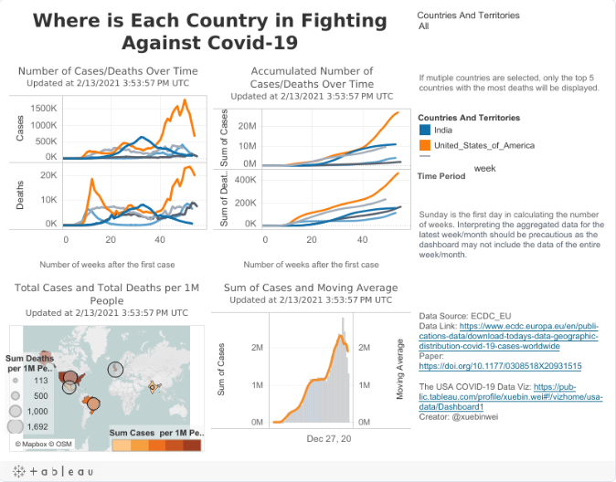

**Source / attribution:** Xuebin Wei, Mingshu Wang, and Menno-Jan Kraak, “Where we are in fighting against COVID-19”; Tableau Public dashboard.

> **Instructor notes:** Start with three concrete questions: What is the subject? What can be compared? What would you select first?

---

## Slide 02 — What is a dashboard?

<!-- chapter: Foundations -->

A dashboard is a **coordinated visual display** that puts the information needed for a purpose in one place.

MonitorCompareInvestigate

A screen full of unrelated charts is not automatically a dashboard.

**Source / attribution:** Paraphrased from Stephen Few, “Dashboard Confusion,” and The Big Book of Dashboards.

> **Instructor notes:** Ask whether “one screen” and “at a glance” are always required. Keep the distinction between monitoring and interactive analysis.

---

## Slide 03 — Directed discovery: show the answer to a known question

<!-- chapter: Foundations -->

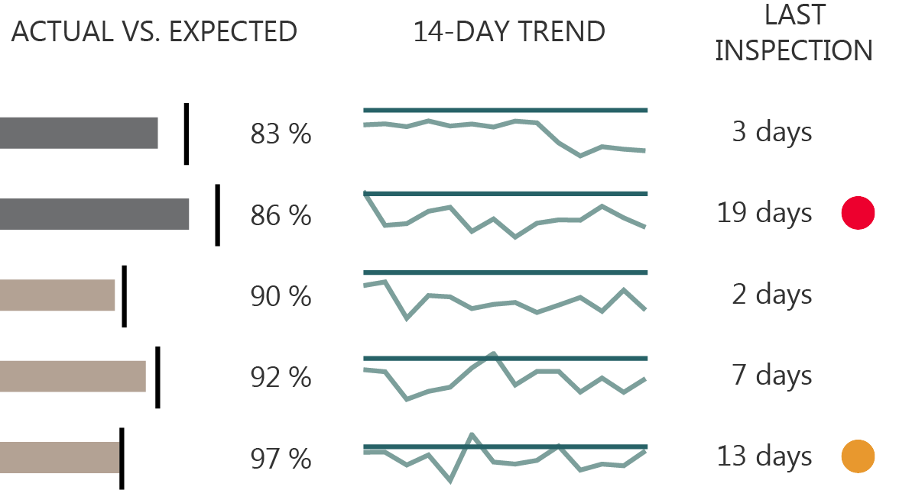

### Known question

Which station needs attention now?

### Visible answer

**19 days** since the last inspection, marked in red.

The reader does not need to invent the first question. The dashboard points to the exception.

**Next step:** check the station marked in red.

**Source / attribution:** Directed discovery: show the answer to a pre-known question. Example from The Big Book of Dashboards.

> **Instructor notes:** This is the concrete replacement for the abstract arrows. The question, evidence, and action are visible in one example.

---

## Slide 04 — Exploratory discovery: follow a question into the data

<!-- chapter: Foundations -->

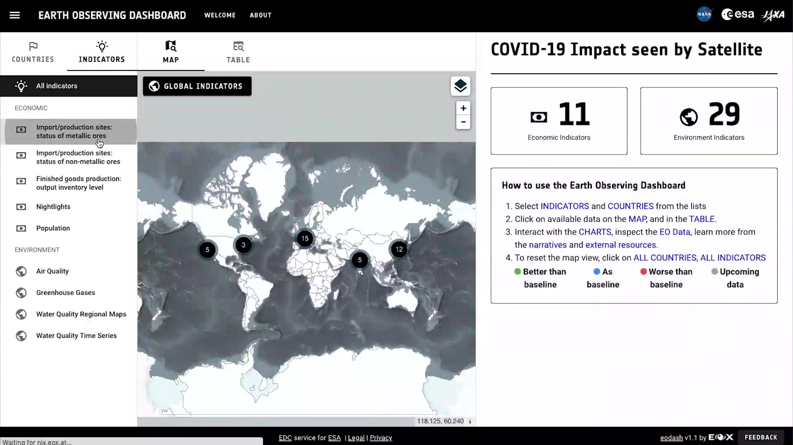

### Start with air quality.

Select an indicator and a location. Inspect the detail view.

### Then ask another question.

- Does another location show the same pattern?
- What changes when you choose a different indicator?
- What does the time series add to the map?

**The reader chooses the next comparison.**

**Source / attribution:** NASA Goddard Space Flight Center, [Earth Observation Dashboard tutorial (2020)](https://svs.gsfc.nasa.gov/13650/).

> **Instructor notes:** Compare this exploratory interface with the inspection example on Slide 3. The map, indicator menu, and visible instructions offer several paths. This is a static historical screenshot, not an embedded live dashboard. The indicator counts shown belong to that historical interface.

---

## Slide 05 — Who will use it—and what do they need to know?

<!-- chapter: Foundations -->

### A finance manager reviewing results

**Question:** Which results missed the budget?

**What the dashboard shows:** the actual result, last year’s result, and the monthly difference from budget.

**What the filters do:** let the manager check a region, sales channel, or product.

Choose the information and controls that help this person answer that question.

**Source / attribution:** Andy Kriebel, [A New Way to Visualize an Income Statement](https://www.vizwiz.com/2017/07/income-statement.html) (2017). Historical design example.

> **Instructor notes:** Point first to a monthly variance-to-budget line, then to the region, channel, and product filters. Explain PY as prior year and YTD as year to date. The design lesson is simple: identify the reader’s question before selecting charts. A finance audience may know these terms; a general audience may not.

---

## Slide 06 — Explicit · Specific · Consistent

<!-- chapter: Foundations -->

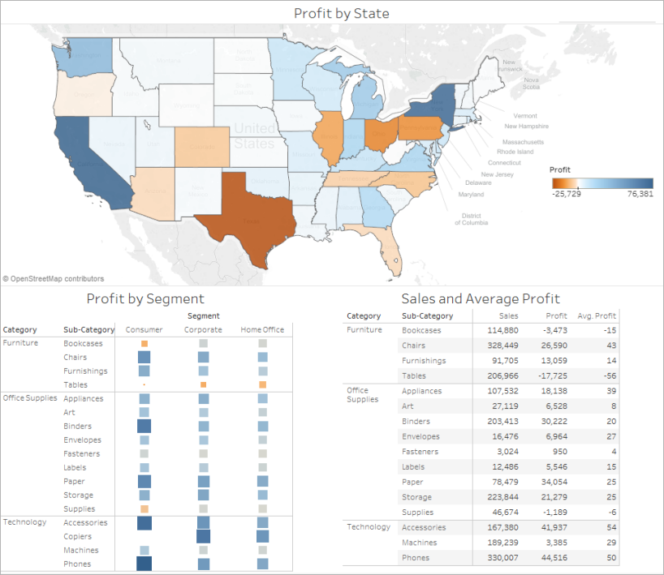

**1 · Explicit**“Profit by State” and the profit legend tell the reader what the map shows.

**2 · Specific**The map, segment comparison, and product table help locate where profit differs.

**3 · Consistent**The map and segment view use the same orange-to-blue profit scale.

**Source / attribution:** Tableau, [Best Practices for Effective Dashboards](https://help.tableau.com/current/pro/desktop/en-us/dashboards_best_practices.htm). Supporting attributes adapted from Stephen Few.

> **Instructor notes:** Point to the title, the large map, the segment grid, and the color legend. The table adds sales and average profit by product sub-category. The example uses fictional Superstore data; discuss design rather than real business performance. Keep each principle tied to a visible element.

---

## Slide 07 — Figure 1(a): compare five countries

<!-- chapter: Foundations -->

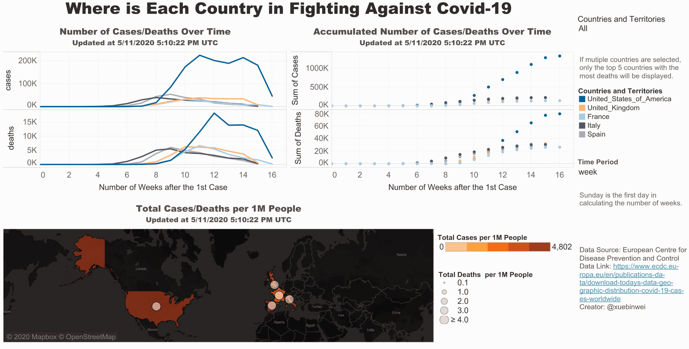

**Look at the same week after the first case.** What do the new and accumulated counts each add?

**Source / attribution:** Wei, X., Wang, M., & Kraak, M.-J. (2020), [Where we are in fighting against COVID-19](https://doi.org/10.1177/0308518X20931515), Figure 1. Original figure supplied by the author.

> **Instructor notes:** This is a panel from the original figure supplied in the chat, not today’s Tableau default view. The screenshot was updated May 11, 2020. The time axis is weeks since the first case. Read cases, deaths, accumulated values, and per-million measures from their own labels; they are not interchangeable. The paper describes this as the group with the highest COVID-19 mortality; do not silently restate it as a mortality-rate ranking.

---

## Slide 08 — Figure 1(b): change the comparison group

<!-- chapter: Foundations -->

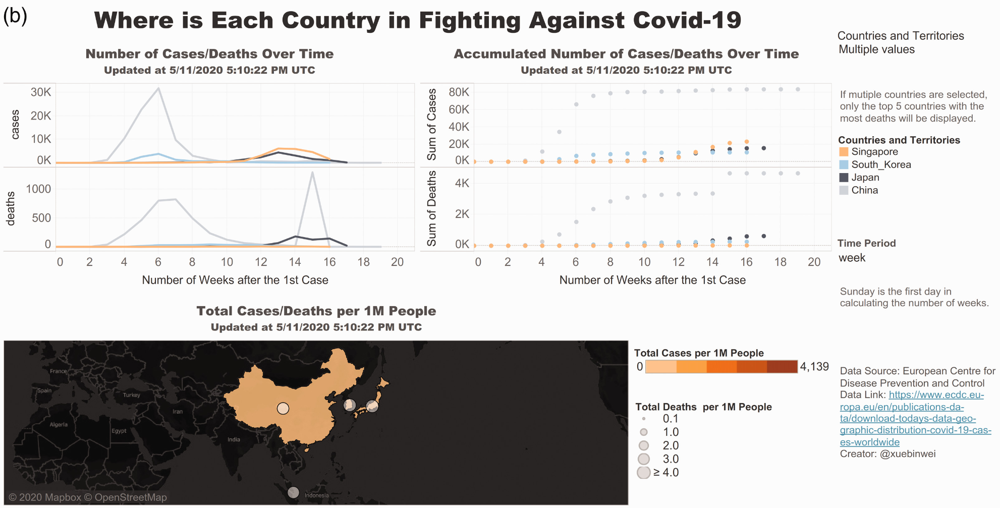

**The selection changes; the layout stays familiar.** Compare the time patterns and read each panel’s scale.

**Source / attribution:** Wei, X., Wang, M., & Kraak, M.-J. (2020), [Where we are in fighting against COVID-19](https://doi.org/10.1177/0308518X20931515), Figure 1. Original figure supplied by the author.

> **Instructor notes:** This is a panel from the original figure supplied in the chat, not today’s Tableau default view. The screenshot was updated May 11, 2020. The time axis is weeks since the first case. Read cases, deaths, accumulated values, and per-million measures from their own labels; they are not interchangeable. The original selection is Singapore, South Korea, Japan, and China. This is the paper’s second panel, not a recreation or an edited data view. The scales differ between the two screenshots.

---

## Slide 09 — Before: what makes this dashboard hard to read?

<!-- chapter: Compare designs -->

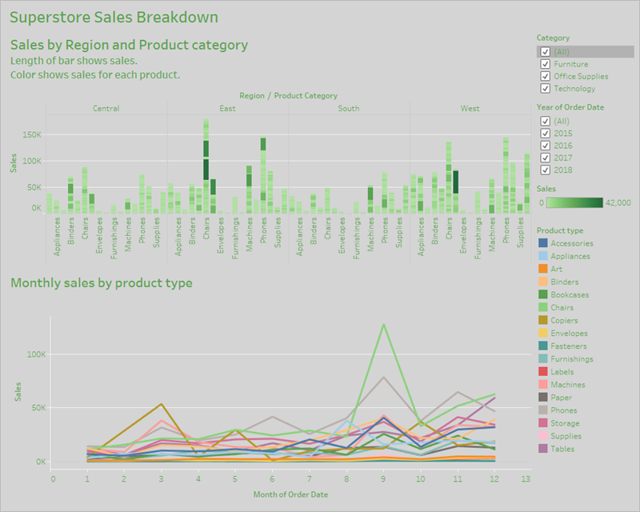

### Find the reading problems

- Pale text is hard to distinguish from the background.
- Many colors compete for attention.
- Crowded marks make comparison difficult.

**Before moving on:** name two changes you would make.

**Source / attribution:** Tableau, [Build Accessible Dashboards](https://help.tableau.com/current/pro/desktop/en-us/accessibility_dashboards.htm). Official before/after example.

> **Instructor notes:** Pause on this version before showing the next page. Ask for specific reading problems rather than a general preference. The next page is Tableau’s published redesign.

---

## Slide 10 — After: make the same task easier

<!-- chapter: Compare designs -->

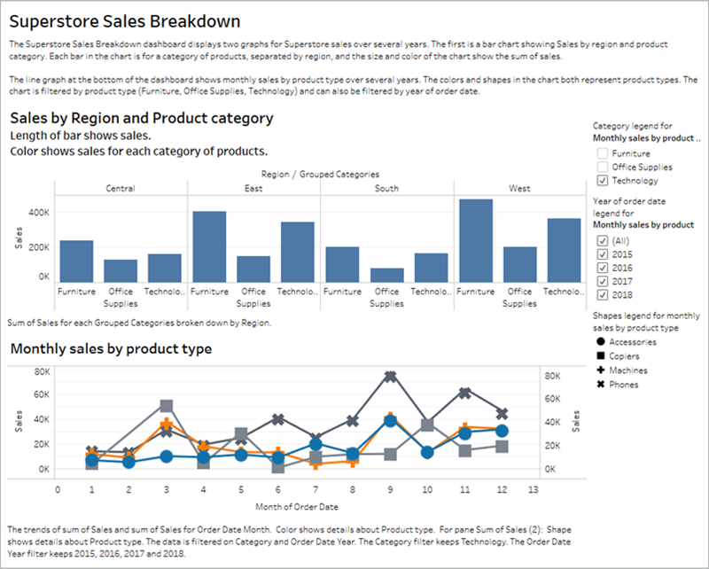

### Connect each change to a problem

- Darker text makes labels easier to read.
- Fewer displayed groups make comparisons less crowded.
- Shapes and labels add meaning alongside color.

Explain what became easier—not just which version looks better.

**Source / attribution:** Tableau, [Build Accessible Dashboards](https://help.tableau.com/current/pro/desktop/en-us/accessibility_dashboards.htm). Official before/after example.

> **Instructor notes:** This redesign changes the aggregation and selected product categories as well as the styling. Explain those changes; it is not only a new color palette. This pair appears once in the lecture.

---

## Slide 11 — Compare: where does the reading effort go?

<!-- chapter: Compare designs -->

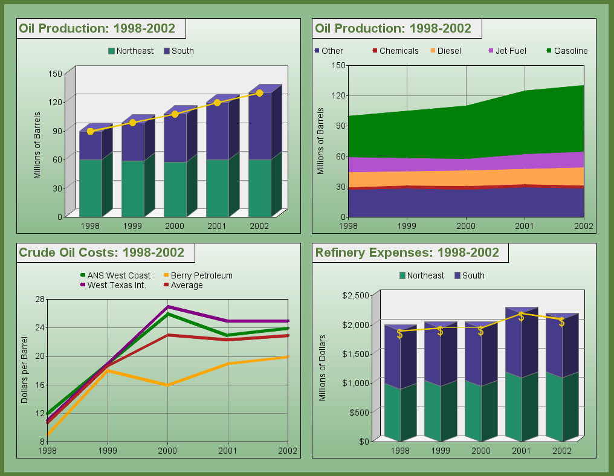

### Look before judging

- Where do your eyes go first?
- Which comparisons are difficult?
- What can be removed without removing information?

**Source / attribution:** Robert Allison, public “blinged” oil dashboard.

> **Instructor notes:** Discuss 3D perspective, gradients, saturated backgrounds, and competing color.

---

## Slide 12 — Compare: reduce effort, preserve meaning

<!-- chapter: Compare designs -->

### What became easier?

- Bars share a common baseline.
- The background stops competing with the data.
- Selective color carries more meaning.

**Still ask:** What would you improve next?

**Source / attribution:** Robert Allison, public “unblinged” oil dashboard.

> **Instructor notes:** The redesign is not perfect. The lesson is that small visual changes can reduce reading effort.

---

## Slide 13 — A widget must earn its space

<!-- chapter: Compare designs -->

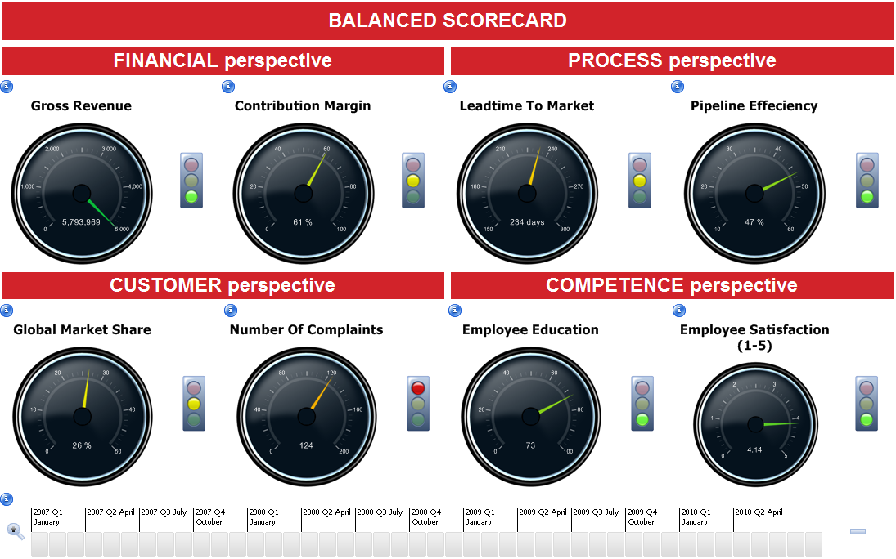

### Ask four direct questions

- Can the values be compared quickly?
- Is there a trend or reference period?
- Are the red–yellow–green thresholds defined?
- How much screen area is used for one number?

A gauge can be appropriate. Decoration alone is not a reason to use one.

**Source / attribution:** TARGIT balanced-scorecard demonstration; public video cited in sources.

> **Instructor notes:** Do not teach “never use gauges.” Teach that a widget must justify its space and support the task.

---

## Slide 14 — The same space can show value and context

<!-- chapter: Compare designs -->

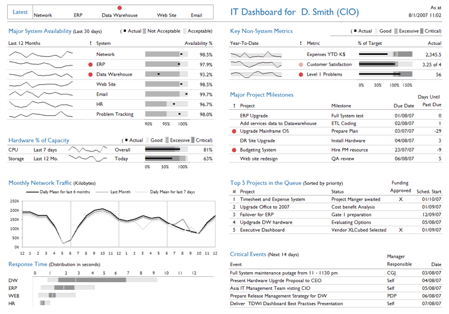

### Small charts can still give useful context

- Show the current value beside a target or comparison.
- Add a recent trend.
- Mark the exceptions that need attention.

**Give the main comparison enough space.** Supporting details do not need equally large panels.

**Source / attribution:** Stephen Few, Information Dashboard Design. Example retained for classroom comparison.

> **Instructor notes:** Compare this page directly with the gauge page. More information is not automatically clutter when it is organized around the reader’s question.

---

## Slide 15 — 1 · Position: place the starting point where it is easy to find

<!-- chapter: Layout & attention -->

### Read the page in order

1. Title and totals establish the subject.
2. Controls define the current scope.
3. Time and geography support the next comparison.

**Direct rule:** put the main question or signal near the top or top-left.

**Source / attribution:** Complaints Dashboard on Tableau Public; featured in The Big Book of Dashboards.

> **Instructor notes:** The top-left rule is a starting point, not a law. Position should match importance and frequency of use.

---

## Slide 16 — 2 · Emphasis: make the important comparison stand out

<!-- chapter: Layout & attention -->

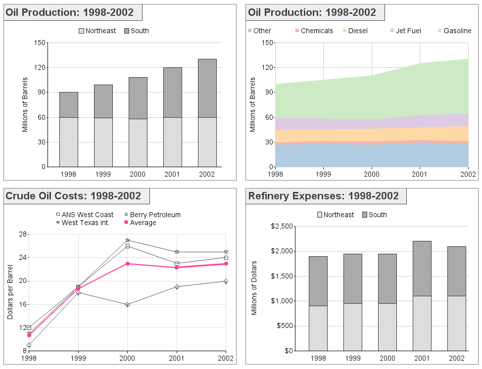

### Use emphasis for meaning

- Quiet background
- Common baselines
- One selective highlight
- Readable titles and units

**Direct rule:** use color and formatting to direct attention, not to decorate every object.

**Source / attribution:** Robert Allison, revised oil dashboard.

> **Instructor notes:** Ask students to identify the first object they notice and whether it deserves that attention.

---

## Slide 17 — 3 · Grouping: keep related information together

<!-- chapter: Layout & attention -->

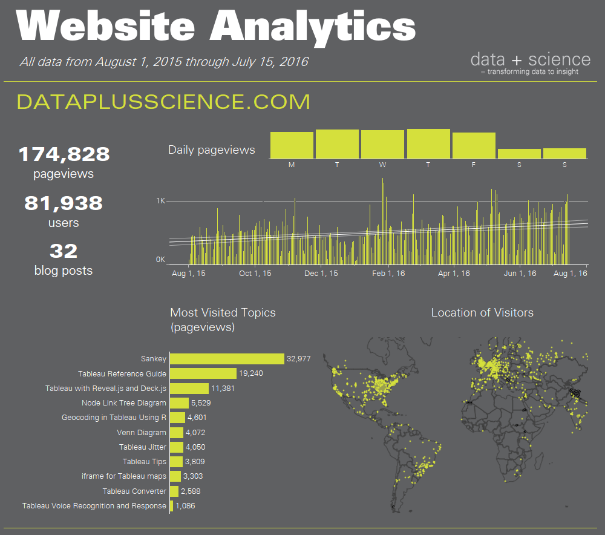

### One subject, four related views

- Totals establish scale.
- The trend shows change over time.
- Topics explain what people viewed.
- The map shows where visitors came from.

**Direct rule:** keep a chart, its legend, and its explanation close together.

**Source / attribution:** Web Analytics chapter, The Big Book of Dashboards.

> **Instructor notes:** Ask which views belong together and which view would be least useful if isolated.

---

## Slide 18 — Apply the four decisions to the research dashboard

<!-- chapter: Layout & attention -->

**1 · Position**Scope and controls frame the comparison.

**2 · Emphasis**Selected countries and measures stand out.

**3 · Grouping**Cases, deaths, titles, and controls stay with the views they explain.

**4 · Proportion**The main comparisons receive enough space; the five-item limit protects readability.

**Source / attribution:** Wei, Wang, and Kraak (2020); public Tableau dashboard.

> **Instructor notes:** Say the four words aloud and point to the matching numbered explanation. The labels remove ambiguity.

---

## Slide 19 — The F pattern: a common scan on text-heavy pages

<!-- chapter: Layout & attention -->

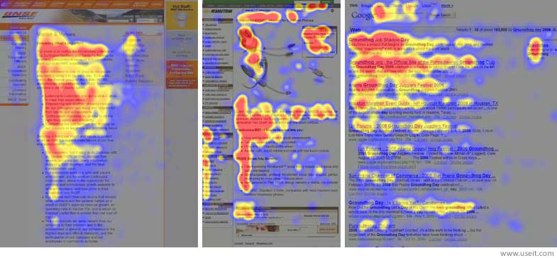

### Typical sequence

1. Long horizontal scan near the top.
2. Shorter horizontal scan lower down.
3. Vertical scan down the left side.

**Important:** this is a common pattern, not a required dashboard template.

**Source / attribution:** Nielsen Norman Group, F-shaped pattern in reading digital content.

> **Instructor notes:** The old lecture made the same qualification: the pattern is partly a product of text-heavy pages.

---

## Slide 20 — Watch the F pattern develop

<!-- chapter: Layout & attention -->

Watch Nielsen Norman Group's **2:40 F-pattern explanation** here. Notice the first horizontal scan, the shorter second scan, and attention moving down the left side.

  <iframe title="F-Pattern in Reading Digital Content — Nielsen Norman Group" src="about:blank" data-src="https://www.youtube-nocookie.com/embed/XU1-Rz2Q7-E?rel=0" loading="lazy" referrerpolicy="strict-origin-when-cross-origin" allow="accelerometer; autoplay; encrypted-media; gyroscope; picture-in-picture; web-share" allowfullscreen></iframe>

[Open the F-pattern video on YouTube if embedded playback is blocked](https://www.youtube.com/watch?v=XU1-Rz2Q7-E)

**Source / attribution:** Nielsen Norman Group, “F-Pattern in Reading Digital Content.”

> **Instructor notes:** This video is specifically about the F pattern. It replaces the earlier unrelated video.

---

## Slide 21 — Dashboard eye tracking: attention can move

<!-- chapter: Layout & attention -->

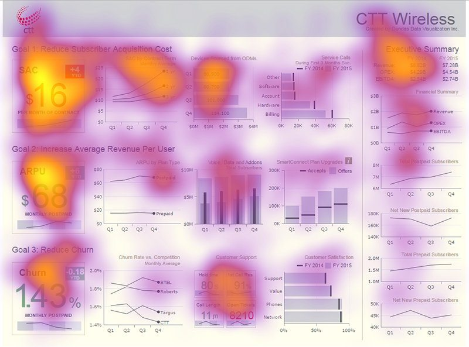

### What the study can show

- Large values attract attention.
- Strong contrast can override position.
- Repeated forms may receive less sustained attention.
- A distinctive chart can redirect the gaze.

Looking at a region is not the same as understanding it.

**Source / attribution:** Tableau, “Eye-Tracking Study: Five Key Learnings.”

> **Instructor notes:** Use the image as evidence about attention—not as proof of comprehension or a universal scan path.

---

## Slide 22 — What grabs attention in this dashboard?

<!-- chapter: Layout & attention -->

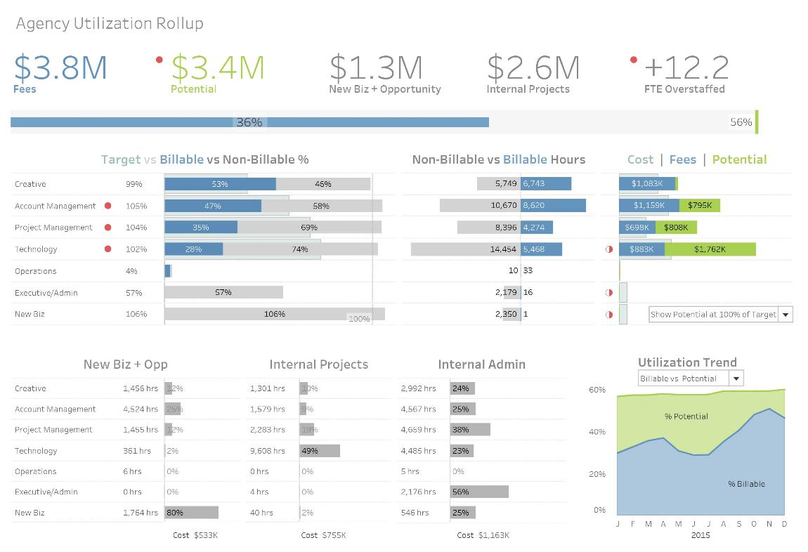

### Notice two areas

**The top row:** large numbers stand out.

**The lower right:** the colored area chart also attracts attention.

**Design lesson:** use size and contrast for the information that matters most.

Then ask a reader to answer a real question. Looking is not the same as understanding.

**Source / attribution:** Agency Utilization Rollup, *The Big Book of Dashboards*; Tableau eye-tracking discussion.

> **Instructor notes:** The original lesson calls attention to the headline numbers and lower-right area chart. Use those two visible features, not a second copy of this dashboard. This is an example of attention, not proof of a universal scan path.

---

## Slide 23 — What makes a dashboard actionable?

<!-- chapter: Actionable dashboards -->

**1 · Purpose**What question does this answer?

**2 · Evidence**Do we have the data needed?

**3 · Audience**Who will use it?

**4 · Insight**Can the important result be seen?

**5 · Next step**What should the reader select, investigate, or decide?

**Source / attribution:** Classroom paraphrase of the five actionable-visualization checks in the prior lecture.

> **Instructor notes:** Use the five pages that follow as examples. The value is in the example, not the wording alone.

---

## Slide 24 — 1 · Make the purpose obvious

<!-- chapter: Actionable dashboards -->

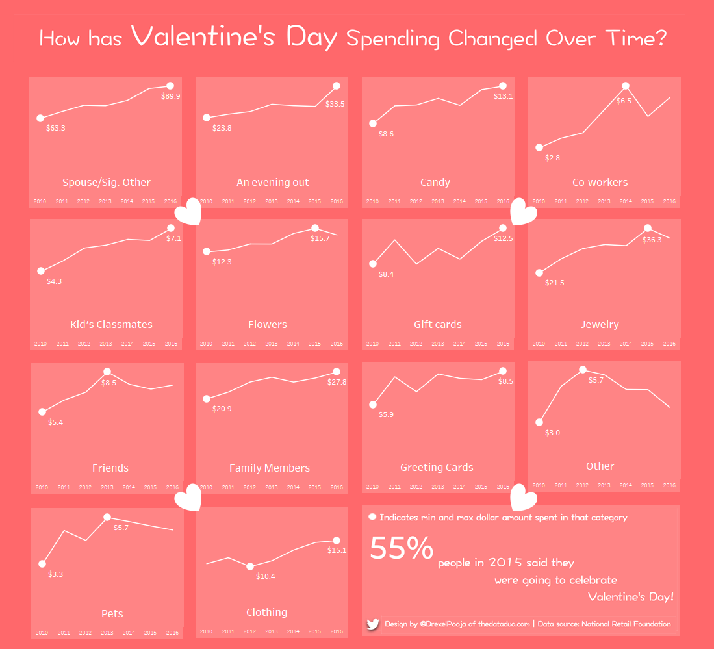

### The title states the question

How has Valentine’s Day spending changed over time?

Every small multiple contributes to that one question.

A question can also be implied by a clear topic and layout—but the reader must still know what the display is for.

**Source / attribution:** Public Tableau example credited to Pooja Gandhi in the prior lecture.

> **Instructor notes:** The purpose is concrete. Students should be able to repeat it without explanation.

---

## Slide 25 — 2 · Make the needed evidence available

<!-- chapter: Actionable dashboards -->

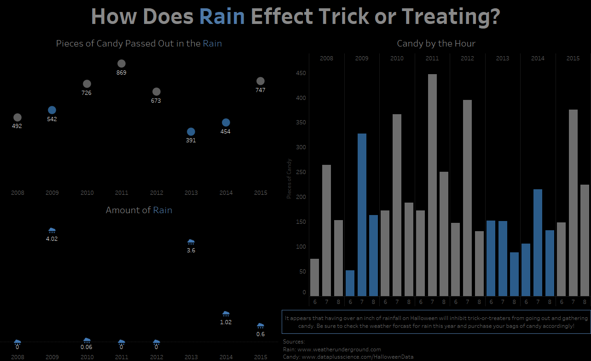

### One question needs two sources

- Candy counts describe activity.
- Weather adds context.
- Dates, units, and missing observations must align.

Do not claim causation from a small observational example. The point is that the question cannot be answered without the second dataset.

**Source / attribution:** Jeffrey Shaffer, Halloween data project.

> **Instructor notes:** Use the example to discuss data availability and compatibility, not to prove that rain caused the result.

---

## Slide 26 — 3 · Design for the person who will use it

<!-- chapter: Actionable dashboards -->

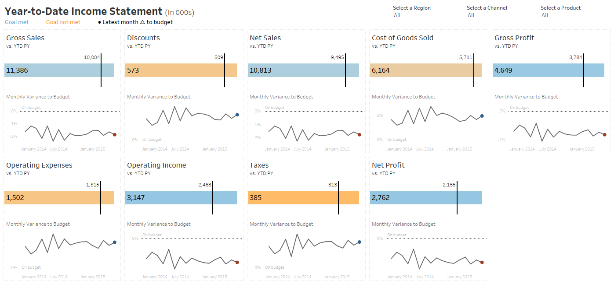

### Audience changes the vocabulary

A finance reader can use gross sales, cost of goods sold, budget variance, and net profit.

A general public dashboard would need simpler language and more explanation.

**Same data does not mean the same dashboard for every reader.**

**Source / attribution:** Andy Kriebel, public Profit & Loss / income-statement Tableau examples.

> **Instructor notes:** This is a specific audience example. Do not turn it into an accounting lesson.

---

## Slide 27 — 4 · Make the important result easy to see

<!-- chapter: Actionable dashboards -->

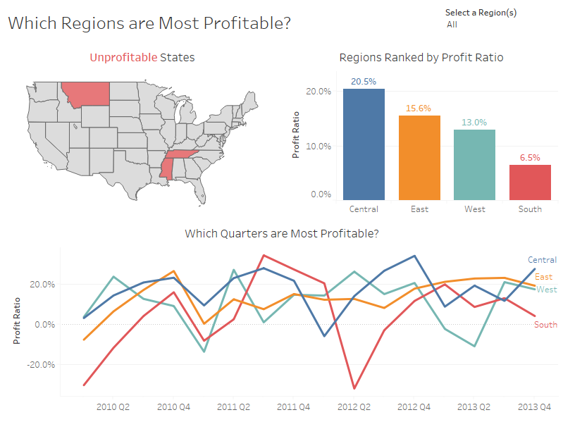

### The answer appears in three ways

- The map shows where losses occur.
- Sorted bars compare regions.
- The line chart shows when performance changes.

The reader should not need a long explanation to find the main result.

**Source / attribution:** Andy Kriebel, “Which Regions are Most Profitable?” public Tableau example.

> **Instructor notes:** Avoid the phrase “verbal rescue.” Say plainly: the main result should not require a long explanation.

---

## Slide 28 — 5 · Make the next interaction clear

<!-- chapter: Actionable dashboards -->

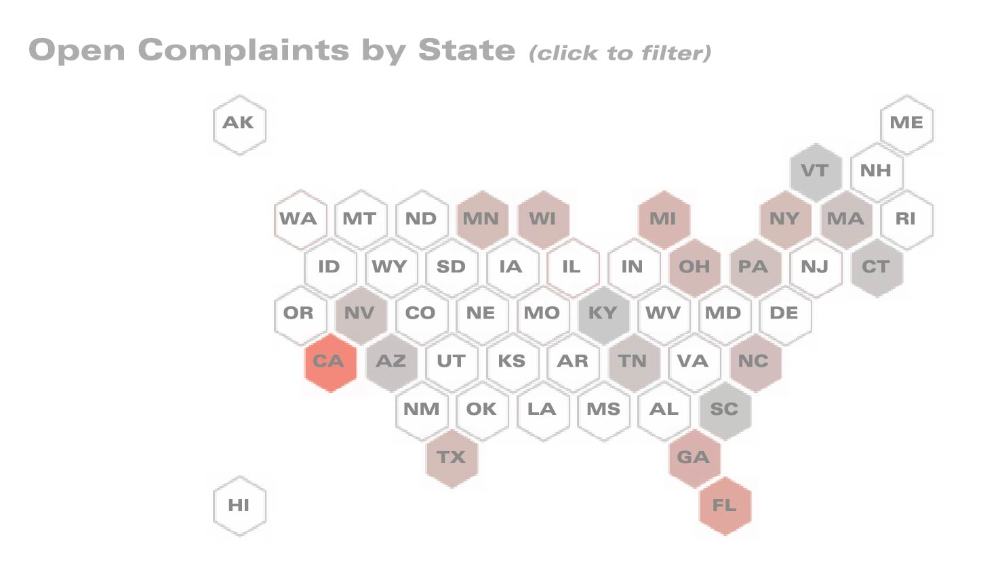

### Tell the reader what to do

- Select a state.
- See the related views update.
- Clear the selection to return to the overview.

Interaction may use a **mouse, touch, keyboard, or another accessible control**. The instruction should describe the action, not assume one device.

**Source / attribution:** Complaints Dashboard, Jeffrey Shaffer / The Big Book of Dashboards.

> **Instructor notes:** Use device-neutral wording in the lecture and the lab: select, activate, clear—not only click.

---

## Slide 29 — The five-second test

<!-- chapter: Test & review -->

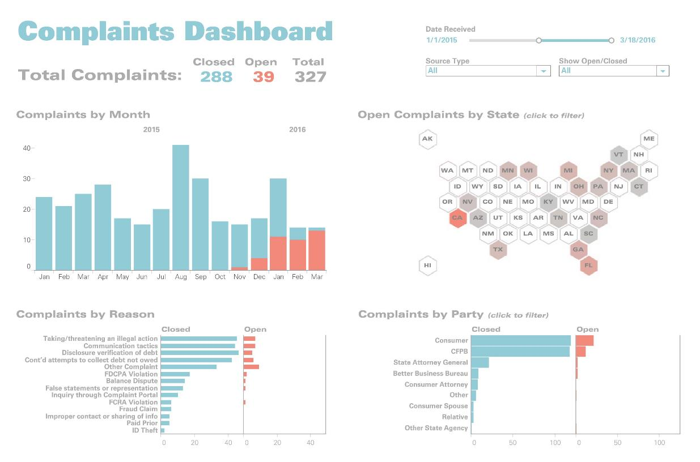

### Look. Then explain.

1. What is the subject?
2. What is the main comparison?
3. What can the reader do next?

Five seconds tests **orientation**, not perfect recall.

Show for 5 secondsReveal for discussionReset

**Source / attribution:** Classroom first-look exercise. Example: Jeffrey A. Shaffer, *Complaints Dashboard*, [The Big Book of Dashboards](https://www.bigbookofdashboards.com/dashboards.html).

> **Instructor notes:** Start with the image covered. Select Show for 5 seconds: the image appears, the countdown runs, and the image is automatically covered again. Reveal for discussion cancels the countdown. Reset covers the image and restores the start state. Leaving the slide or hiding the browser tab cancels an active attempt; start again when the class is ready. The controls support pointer, touch, and keyboard activation.

---

## Slide 30 — Three “five” rules for this class

<!-- chapter: Test & review -->

**5 seconds**Subject, main signal, and next action should be recognizable.

**5 views or fewer**A useful starting point for a focused dashboard.

**Fewer than 5 prominent colors**Use a limited palette; reserve strong color for meaning.

These are classroom starting rules—not universal laws. Break one only when the task gives you a clear reason.

**Source / attribution:** Five views or fewer and the five-second test come from the prior lecture. The limited-color rule is a course design heuristic.

> **Instructor notes:** Be explicit: “prominent colors” means the colors competing for attention, not every tint used for backgrounds or accessibility.

---

## Slide 31 — Numbers show what. A story explains why it matters.

<!-- chapter: Storytelling -->

NUMBERS

### What happened?

Show the values, comparisons, and changes.

Keep the evidence accurate.

STORY

### Why should we care?

Give the question, a clear sequence, and the main takeaway.

Help the audience connect the pieces.

**The next step:** after building a readable dashboard, guide the audience through one finding.

**Source / attribution:** Illustration detail: Staying Alive UK, reproduced in the supplied lecture. Numbers-and-stories teaching connection adapted from Jeffrey A. Shaffer.

> **Instructor notes:** The prior lecture uses a math/stories contrast and notes that left/right-brain language is more complicated. Keep the illustration as a metaphor, not as a claim that people or tasks belong to separate brain halves. The original infographic’s dopamine and two-brain-area statements are not reproduced. This is a brief bridge to the next topic, not a competing alternative to dashboard design.

---

## Slide 32 — Attract · Engage · Punchline

<!-- chapter: Storytelling -->

**Attract**State a relevant question and define the scope.*“Which regions are losing money?”*

**Engage**Guide the comparison with sequence, size, color, and interaction.*Map → ranked bars → trend*

**Punchline**Make the takeaway or next question clear.*“Investigate these states first.”*

Storytelling changes emphasis and sequence. It does not excuse weak evidence.

**Source / attribution:** Adapted from the Attract–Engage–Punchline framework in the prior lecture.

> **Instructor notes:** Use one concrete example for all three parts. Do not leave the terms as abstract slogans.

---

## Slide 33 — Watch a data story unfold

<!-- chapter: Storytelling -->

Play a 60-second Hans Rosling segment

Watch how the speaker keeps the axes stable, directs attention at the right moment, and connects movement to a clear claim.

[Open the full BBC video](https://www.youtube.com/watch?v=jbkSRLYSojo)

**Source / attribution:** BBC, Hans Rosling: “200 Countries, 200 Years, 4 Minutes.”

> **Instructor notes:** Use only the selected segment. Ask students what the narration adds that the animation alone would not provide.

---

## Slide 34 — Final design review

<!-- chapter: Review -->

**Purpose**Can a new reader state the question?

**Evidence**Does each view answer part of that question?

**Hierarchy**Do position, emphasis, grouping, and proportion match importance?

**Consistency**Do color, labels, and controls keep the same meaning?

**Interaction**Can the reader select, understand the result, and clear it?

**First look**Five seconds · five views or fewer · fewer than five prominent colors.

**Test**Did another person complete the task without coaching?

**Source / attribution:** Course review checklist synthesized from the lecture examples.

> **Instructor notes:** Close with this page. The lab handout contains the construction and grading details.

---

## Slide 35 — Sources and public examples

<!-- chapter: References -->

**Research dashboard:** Wei, X., Wang, M., & Kraak, M.-J. (2020). [Where we are in fighting against COVID-19](https://doi.org/10.1177/0308518X20931515); [Tableau Public dashboard](https://public.tableau.com/app/profile/xuebin.wei/viz/covid19_15842259755690/Dashboard).

**Additional teaching cases:** [NASA Goddard Earth Observation Dashboard](https://svs.gsfc.nasa.gov/13650/); [Andy Kriebel’s income statement](https://www.vizwiz.com/2017/07/income-statement.html); [Tableau Superstore](https://help.tableau.com/current/pro/desktop/en-us/dashboards_best_practices.htm); [Tableau accessibility walkthrough](https://help.tableau.com/current/pro/desktop/en-us/accessibility_dashboards.htm).

**Dashboard foundations:** Stephen Few, Dashboard Confusion and Information Dashboard Design; The Big Book of Dashboards.

**Public examples:** Robert Allison oil dashboards; TARGIT balanced-scorecard video; Jeffrey Shaffer Complaints and Website Analytics dashboards; Andy Kriebel public Tableau examples; Jeffrey Shaffer Halloween data project; Tableau accessibility guidance.

**Attention:** Nielsen Norman Group F-pattern research and video; Tableau eye-tracking study.

**Story and memory:** Bower & Clark (1969), Narrative stories as mediators for serial learning; Stephens, Silbert, & Hasson (2010), Speaker–listener neural coupling underlies successful communication; BBC Hans Rosling video.

Public availability does not place an image in the public domain. Retain creator attribution and instructional context.

**Source / attribution:** Source record for the IA342 Week 10 instructor-review draft.

> **Instructor notes:** This is the final source page. This is an instructor-review PR; do not merge or publish to Canvas without Owner approval.

---

<!-- Revision: 2026-10-21-figure-panels-dedup-old-lab-screenshots. Original Figure 1(a)/(b) inserted from the author-supplied image. -->

