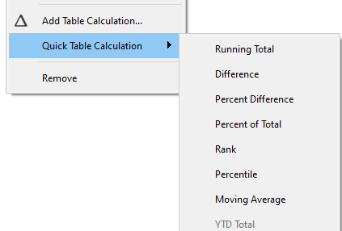
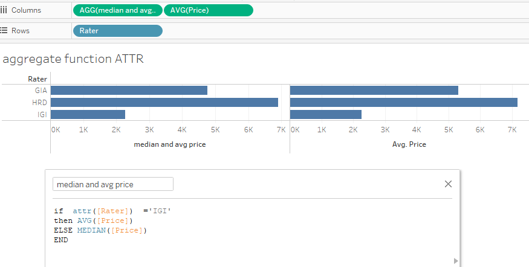
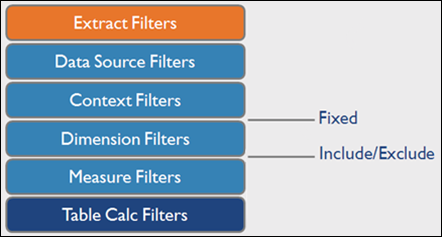

## Calculations in Tableau

<!-- source-slide:1 -->

Xuebin Wei  
James Madison University

## Diamonds dataset

One record describes **one diamond**. We will use this same dataset throughout the lecture.


<!-- markdown-fallback:start -->
| IDNO | WEIGHT | COLOR | CLARITY | RATER | PRICE |
|---:|---:|---|---|---|---:|
| 1 | 0.30 | D | VS2 | GIA | 1,302 |
| 2 | 0.30 | E | VS1 | GIA | 1,510 |
| 3 | 0.30 | G | VVS1 | GIA | 1,510 |
| 4 | 0.30 | G | VS1 | GIA | 1,260 |
| 5 | 0.31 | D | VS1 | GIA | 1,641 |
| 6 | 0.31 | E | VS1 | GIA | 1,555 |
| 7 | 0.31 | F | VS1 | GIA | 1,427 |
| 8 | 0.31 | G | VVS2 | GIA | 1,427 |
<!-- markdown-fallback:end -->

**308 diamonds.** `IDNO` identifies a diamond; `RATER`, `COLOR`, and `CLARITY` describe it; `WEIGHT` and `PRICE` are numeric measures. Treat `IDNO` as a dimension.

Source: [Course Diamonds CSV](https://github.com/xbwei/data-analysis-with-generative-ai/blob/main/diamonds.csv).

## Calculations in Tableau

<!-- source-slide:2 -->

Calculations transform existing data into new values. A formula combines **functions**, **fields**, and **operators**.

| Calculation | What it uses | Diamonds example |
|---|---|---|
| Regular calculation: row level | Values from an individual source record | `[PRICE] / [WEIGHT]` |
| Regular calculation: aggregate | Records belonging to a group in the view | `SUM([PRICE]) / SUM([WEIGHT])` |
| Table calculation | Results already returned to the view | Percent of Total or Running Total |

Regular calculations are evaluated as part of the data-source query. Table calculations operate on the resulting view inside Tableau.

Functions include **number, string, date, logical, and type conversion** functions.

## Calculation Syntax

<!-- source-slide:3 -->

| Component | Syntax | Example |
|---|---|---|
| Function | Function name followed by arguments in parentheses | `SUM([PRICE])` |
| Field | Field name in square brackets | `[WEIGHT]` |
| Operator | Arithmetic, comparison, or logical operation | `[WEIGHT] >= 1` |
| Literal | A value written directly in the formula | `1`, `"GIA"`, `#2000-01-01#`, `TRUE`, `NULL` |
| Parameter | A user-controlled value, also in square brackets | `[Minimum Weight]` |
| Comment | Two forward slashes before the comment | `// Price per carat` |

Arithmetic: `+` `-` `*` `/` `%` `^` · Comparison: `=` `==` `!=` `<>` `>` `<` `>=` `<=` · Logic: `AND` `OR` `NOT`. Parentheses control the order of operations.

<!-- widget:syntax -->

<!-- markdown-fallback:start -->
```tableau
IF [WEIGHT] > 0.5 THEN "big" ELSE "small" END
```
<!-- markdown-fallback:end -->

Reference: [Writing calculations in Tableau](https://help.tableau.com/current/pro/desktop/en-us/functions_operators.htm).

## Basic Functions

<!-- source-slide:4 -->


<!-- markdown-fallback:start -->
Examples for IDNO 1 (WEIGHT 0.30, PRICE 1,302, RATER GIA):

| Type | Example | Result |
|---|---|---|
| Date | `DATEDIFF('day', #2000-01-01#, #2000-01-03#)` | 2 days |
| Logical | `IF [WEIGHT] > 0.5 THEN "big" ELSE "small" END` | `"small"` |
| String | `LOWER([RATER])` | `"gia"` |
| Number | `ROUND([WEIGHT], 1)` | 0.3 |
| Null handling | `ZN([PRICE])`; `ZN(NULL)` | 1,302; 0 |
| Type conversion | `STR([IDNO])` | `"1"` |

Diamonds has no date field; the date example uses two date literals.
<!-- markdown-fallback:end -->

Logical expressions can define a calculated field or a filter. For example, **`AVG([WEIGHT]) > 0.5`** keeps groups whose average weight is greater than 0.5.

**`ZN()` returns its input when it is not NULL; otherwise, it returns zero.** A missing value and a measured zero do not necessarily mean the same thing.

References: [Date functions](https://help.tableau.com/current/pro/desktop/en-us/functions_functions_date.htm) · [Logical functions and ZN](https://help.tableau.com/current/pro/desktop/en-us/functions_functions_logical.htm) · [Function reference](https://help.tableau.com/current/pro/desktop/en-us/functions_all_categories.htm).

## Table Calculation

<!-- source-slide:5 -->

A table calculation operates on the **aggregated results in the current view**.

- Adding or removing dimensions changes the view and can change the calculation.
- Quick Table Calculations apply common operations to an existing measure.
- A table calculation can be saved as a calculated field.



For Diamonds, first count the diamonds in each group. Then calculate each group's **percent of total**, **running total**, or another transformation of those counts.

Reference: [Table calculations](https://help.tableau.com/current/pro/desktop/en-us/calculations_tablecalculations.htm).

## Scope and Direction

<!-- source-slide:6 -->

Keep the same counts. Change **which cells share the denominator**. The 100% totals show where the calculation restarts.

<!-- widget:scopeSimple -->

| RATER | D | E | F | G | H | I | Total |
|---|---:|---:|---:|---:|---:|---:|---:|
| GIA | 10 | 25 | 40 | 26 | 29 | 21 | 151 |
| HRD | 2 | 10 | 19 | 17 | 22 | 9 | 79 |
| IGI | 4 | 9 | 23 | 22 | 10 | 10 | 78 |
| Total | 16 | 44 | 82 | 65 | 61 | 40 | 308 |

Percent of Total = `COUNTD([IDNO]) / TOTAL(COUNTD([IDNO]))`.

For **RATER = GIA, COLOR = D**:

| Compute Using | Denominator | Selected cell | Where the total is 100% |
|---|---:|---:|---|
| Across | 151 | 6.62% | At the end of each row |
| Down | 16 | 62.50% | At the bottom of each column |
| Entire table | 308 | 3.25% | Bottom-right grand total |

The HTML shows original counts and calculated percentages side by side. Only Percent of Total is calculated in this demonstration.

<details>
<summary>Extend the example: Pane, Cell, and Specific Dimensions</summary>

<!-- source-slide:6 -->

Now add **COLOR beneath RATER** in Rows, with **CLARITY** in Columns. Each RATER block is a pane. This extends the preceding two-dimensional example rather than repeating it.

<!-- widget:scopePanes -->

For **RATER = GIA, COLOR = E, CLARITY = VS1**, count = 16:

| Scope | Denominator | Percent of Total | 100% boundary |
|---|---:|---:|---|
| Table Across | 25 | 64.00% | Each row |
| Table Down | 81 | 19.75% | Each column across all raters |
| Pane Down | 61 | 26.23% | Each rater–clarity column inside its pane |
| Pane | 151 | 10.60% | Each rater subtotal |
| Entire table | 308 | 5.19% | Grand total |
| Cell | 16 | 100.00% | Each nonempty cell |

**Scope** is the group of marks used. **Direction** is how the calculation moves through them. Under Specific Dimensions, checked fields are **addressing** and unchecked fields define **partitions**. For the GIA pane, check COLOR and CLARITY; leave RATER unchecked.

The highlighted partition always totals 100%. Displayed percentages can differ slightly due to rounding. Missing combinations have no record and are shown as —, not invented zero-valued marks.

</details>

## Aggregate Functions

<!-- source-slide:7 -->

Aggregate functions summarize records and change the level of detail.

| Function | Result for the records in a mark |
|---|---|
| `SUM([PRICE])` | Total price |
| `AVG([PRICE])`, `MEDIAN([PRICE])` | Mean or median price |
| `MIN([PRICE])`, `MAX([PRICE])` | Smallest or largest price |
| `COUNT([IDNO])`, `COUNTD([IDNO])` | Non-null count or distinct count |
| `ATTR([RATER])` | One shared value, or `*` when several values are present |

Constants work with either level: both `SUM([PRICE] * 1.05)` and `SUM([PRICE]) * 1.05` are valid.

**`AGG(...)` identifies a field whose formula already contains aggregation.** Tableau does not apply another ordinary SUM or AVG to that field. `AGG` is the displayed label, not a function to type.

Reference: [Aggregate functions and rules](https://help.tableau.com/current/pro/desktop/en-us/calculations_calculatedfields_aggregate_create.htm).

## ATTR: do the records agree?

<!-- source-slide:7,8 -->

Look inside **one mark**. If every non-null value agrees, `ATTR()` returns that value; if the values disagree, it displays `*`.

<!-- widget:attrEvidence -->

| Source records represented by one GIA mark | PRICE values | Distinct prices | ATTR(PRICE) |
|---|---|---:|---|
| IDNO 1 | 1,302 | 1 | 1,302 |
| IDNO 2 and 3 | 1,510; 1,510 | 1 | 1,510 |
| IDNO 1, 2, and 3 | 1,302; 1,510; 1,510 | 2 | * |

**One distinct value does not mean one record.** Multiple records with an identical price still return that number. The asterisk means multiple values, not multiplication, missing data, or an error.

Add IDNO to Rows to split the source records into one mark per diamond. Each mark then has one PRICE. `ATTR([RATER])` can return text, such as GIA. The HTML displays RATER and IDNO as separate columns, not slash-separated labels.

Reference: [ATTR](https://help.tableau.com/current/pro/desktop/en-us/calculations_calculatedfields_aggregate_create.htm).

## ATTR in an aggregate calculation

<!-- source-slide:8 -->

This calculation uses an average for IGI and a median for the other raters:

```tableau
IF ATTR([RATER]) = "IGI" THEN AVG([PRICE])
ELSE MEDIAN([PRICE])
END
```



`ATTR([RATER])` makes the condition aggregate, so it is compatible with `AVG([PRICE])` and `MEDIAN([PRICE])`. The view contains one mark per rater.

## Aggregate and non-aggregate values

<!-- source-slide:7 -->

**A calculation cannot mix an aggregate value with an individual row value.** Arguments to a function must also use compatible levels.

<!-- widget:invalid-mix -->

<!-- markdown-fallback:start -->
| Invalid expression | Error | Compatible expression |
|---|---|---|
| `SUM([PRICE]) / [WEIGHT]` | `[WEIGHT]` is a row value, while the numerator is aggregate | `SUM([PRICE]) / SUM([WEIGHT])` |
| `MAX(AVG([PRICE]), [PRICE])` | The arguments mix aggregate and row values | `MAX(AVG([PRICE]), MEDIAN([PRICE]))` |
<!-- markdown-fallback:end -->

The expression **`AVG([PRICE]) + [PRICE]`** has the same error: the first part summarizes a group, while the second part still describes a row.

A formula can be syntactically valid and still calculate the wrong quantity. The next example shows why.

Reference: [Rules for aggregate calculations](https://help.tableau.com/current/pro/desktop/en-us/calculations_calculatedfields_aggregate_create.htm).

## Unit price or overall ratio?

A formula containing division can answer different questions. Decide whether the result describes **each record** or **the whole group**.

<!-- widget:ratioDecision -->

### Each diamond's unit price: calculate at row level

`[PRICE] / [WEIGHT]`

| IDNO | PRICE | WEIGHT | Price per carat |
|---:|---:|---:|---:|
| 1 | 1,302 | 0.30 | 4,340.00 |
| 116 | 15,582 | 1.00 | 15,582.00 |

Each object needs its own unit price. AVG(row unit price) = **9,961.00**, giving each diamond equal weight. Do not SUM unit prices to report an overall unit price.

### Overall deaths-to-cases ratio: aggregate first, then divide

Illustrative counts only; these are not observed COVID data. The lab calls deaths divided by cases “death rate.”

| Group | Deaths | Cases | Row ratio |
|---|---:|---:|---:|
| A | 2 | 10 | 20.00% |
| B | 3 | 90 | 3.33% |
| Combined | 5 | 100 | **5.00%** |

`SUM([Deaths]) / SUM([Cases]) = (2 + 3) / (10 + 90) = 5.00%`

AVG(row ratios) = 11.67%; SUM(row ratios) = 23.33%. Neither answers the combined-rate question.

**Choose the calculation level from the question:** one value for each object → row calculation; one overall rate for a group → aggregate numerator and denominator first.

Optional comparison: for one price per carat for the entire diamond group, `SUM([PRICE]) / SUM([WEIGHT]) = 16,884 / 1.30 = 12,987.69`. That weights by carat rather than giving each diamond equal weight. Both averages can be useful, but they answer different questions.

## Level of Detail Expressions

<!-- source-slide:9 -->

**LOD expressions give more control on the level of granularity you want to compute.**

```text
{ [FIXED | INCLUDE | EXCLUDE] <dimension declaration> : <aggregate expression> }
```

| Keyword | Definition |
|---|---|
| FIXED | Compute values using the specified dimensions **without reference to the view**. |
| INCLUDE | Compute values using the specified dimensions **in addition to dimensions in the view**. |
| EXCLUDE | Explicitly **remove dimensions** from the expression. |

If no dimension is declared, the LOD is **table scoped**. The aggregate expression cannot contain `ATTR` or table calculations.

**View level:** RATER and CLARITY means one mark for each combination.

**Calculation level:** `{ FIXED [RATER] : AVG([PRICE]) }` means one average for each RATER.

## FIXED, INCLUDE, and EXCLUDE

<!-- source-slide:10 -->

Keep **RATER and CLARITY** in the view. One mark means one combination: for example, **GIA and IF** contains **6 diamonds with $47,769 in total price**. The following four calculations answer different grouping questions.

| Calculation | Tableau formula | Records used for GIA–IF | Result |
|---|---|---|---:|
| Ordinary view AVG | `AVG([PRICE])` | GIA + IF, 6 diamonds: 47,769 ÷ 6 | **7,961.50** |
| FIXED RATER | `{ FIXED [RATER] : AVG([PRICE]) }` | All 151 GIA diamonds: 801,873 ÷ 151 | **5,310.42** |
| INCLUDE RATER | `{ INCLUDE [RATER] : AVG([PRICE]) }` | RATER is already in the view; 47,769 ÷ 6 | **7,961.50** |
| EXCLUDE RATER | `{ EXCLUDE [RATER] : AVG([PRICE]) }` | All 44 IF diamonds across three raters: 118,570 ÷ 44 | **2,694.77** |

**Read the field declaration, not just the value:** FIXED selects its own grouping dimensions; INCLUDE adds to the view's dimensions; EXCLUDE removes from them. In the interactive table, click a result to inspect the contributing groups and records.

<!-- widget:lod-types -->

## LOD and Aggregation

<!-- source-slide:11 -->

**FIXED computes values using the specified dimensions without reference to the view's LOD.** The original lecture gives three possible relationships:

- **More granular than the view:** multiple FIXED results must be **aggregated** into one view mark.
- **Less granular than the view:** one FIXED result is **replicated** into several view marks.
- **Entirely disjoint dimensions:** FIXED and the view share no grouping dimension, so the values are **aggregated at table scope** before being displayed.

**INCLUDE results are below Viz LOD and to be aggregated in the view.**

**EXCLUDE results are above Viz LOD and to be replicated in the view.**

Here, **below** means finer/more detailed and **above** means coarser/less detailed. The view still needs a visible aggregation choice such as `AVG([calculated field])`; it is not the same as the `AVG([PRICE])` inside a FIXED expression.

## LOD and Aggregation: examples

<!-- source-slide:12 -->

<!-- widget:lod-aggregation -->

### Scenario 1 — FIXED: Replicated (coarser calculation → finer view)

**Calculate by RATER; display by RATER and CLARITY.**

Create `[Avg Price per Rater]`:

```tableau
{ FIXED [RATER] : AVG([PRICE]) }
```

Display it as `AVG([Avg Price per Rater])` in a view with RATER and CLARITY. For GIA, **801,873 ÷ 151 = 5,310.42**. The GIA–IF mark has only **6 diamonds** and an ordinary average price of **7,961.50**, but the FIXED result **5,310.42** is repeated in GIA–IF, GIA–VS1, GIA–VS2, GIA–VVS1 and GIA–VVS2.

**Why?** The calculation has one value per RATER, while the view has five marks within each RATER. This is **replication, not recalculation of five distinct GIA averages**.

### Scenario 2 — FIXED: Aggregated (finer calculation → coarser view)

**Calculate by RATER and CLARITY; display by CLARITY only.**

Create `[Avg Price per Rater and Clarity]`:

```tableau
{ FIXED [RATER], [CLARITY] : AVG([PRICE]) }
```

Then in the view, use:

```tableau
AVG([Avg Price per Rater and Clarity])
```

For CLARITY = IF, the first calculation produces **three distinct LOD results**:

| RATER | CLARITY | Number of diamonds | Sum of PRICE | First AVG(PRICE) |
|---|---|---:|---:|---:|
| GIA | IF | 6 | 47,769 | 47,769 ÷ 6 = **7,961.50** |
| HRD | IF | 4 | 26,133 | 26,133 ÷ 4 = **6,533.25** |
| IGI | IF | 34 | 44,668 | 44,668 ÷ 34 = **1,313.76** |

Now the second AVG combines **those three group means**, not the 44 diamonds:

\[
\frac{7,961.50 + 6,533.25 + 1,313.7647\ldots}{3} = \mathbf{5,269.50}
\]

For contrast, direct `AVG([PRICE])` across the 44 IF diamonds is **118,570 ÷ 44 = 2,694.77**. The two answers are different because **an average of group averages gives each RATER group equal weight**, whereas an average of records gives each diamond equal weight.

### Scenario 3 — FIXED: Disjoint (different dimensions)

**Calculate by RATER; display by CLARITY only.** Reuse the first field:

```tableau
{ FIXED [RATER] : AVG([PRICE]) }
```

The three FIXED RATER results are:

| RATER | Number of diamonds | Sum of PRICE | RATER-level AVG |
|---|---:|---:|---:|
| GIA | 151 | 801,873 | **5,310.42** |
| HRD | 79 | 567,293 | **7,180.92** |
| IGI | 78 | 176,835 | **2,267.12** |

Use `AVG([Avg Price per Rater])` with CLARITY in the view:

\[
\frac{5,310.4172\ldots + 7,180.9241\ldots + 2,267.1154\ldots}{3} = \mathbf{4,919.49}
\]

RATER and CLARITY are **disjoint** (no shared grouping field): the result is aggregated at table scope, then **4,919.49** is replicated for IF, VS1, VS2, VVS1 and VVS2. All calculations use unrounded values before formatting.

## LOD and Filters

<!-- source-slide:13 -->



- **FIXED** is calculated before ordinary dimension filters. Context, data-source, and extract filters still affect its input.
- **INCLUDE and EXCLUDE** are calculated after dimension filters.
- INCLUDE and EXCLUDE produce measures. A FIXED field can be a dimension or measure, depending on the expression's result.

Reference: [Filters and LOD expressions](https://help.tableau.com/current/pro/desktop/en-us/calculations_calculatedfields_lod_filters.htm).

## LOD and Filters: the denominator

<!-- source-slide:13 -->

This calculation gives each rater's share of total price:

<!-- markdown-fallback:start -->
```tableau
SUM([PRICE]) / ATTR({ SUM([PRICE]) })
```
<!-- markdown-fallback:end -->

<!-- widget:lod-filters -->

<!-- markdown-fallback:start -->
| Rater | Ordinary filter | Context filter |
|---|---:|---:|
| GIA | 51.87% | 58.57% |
| HRD | 36.69% | 41.43% |
| Visible total | 88.56% | 100.00% |
<!-- markdown-fallback:end -->

<!-- markdown-fallback:start -->
With only **GIA and HRD** selected, an ordinary RATER filter leaves the denominator at **1,546,001**, the total for all three raters. A context filter changes it to **1,369,166**, the total for the selected raters.
<!-- markdown-fallback:end -->

Reference: [FIXED and filter order](https://help.tableau.com/current/pro/desktop/en-us/calculations_calculatedfields_lod_filters.htm).

## Nested LOD — identify the inner and the outer

<!-- source-slide:14 -->

**Nested means that one full LOD expression appears INSIDE the aggregate part of another LOD expression.** The outer braces are the parent; the inner braces are the child. The same expression can be entered in one Tableau calculated field:

**OUTER LOD:** The first `FIXED` declares no grouping dimensions, so its result is table-wide. **INNER LOD:** The second `FIXED`, inside the first AVG, groups by RATER and CLARITY.

```tableau
{ FIXED : AVG(
    { FIXED [RATER], [CLARITY] : AVG([PRICE]) }
) }
```

**Original lecture principle:** *The context for an inner calculation is defined by its parent.* When the outer FIXED declares no dimensions, the parent context is the whole table. The inner calculation still produces its 15 RATER-and-CLARITY groups within that context.

### What happens to the data? (two calculations, then a display)

**Step 1 — Inner LOD (finer):** `{ FIXED [RATER], [CLARITY] : AVG([PRICE]) }`

The 308 diamonds form **3 RATER × 5 CLARITY = 15 groups**. Each group gives one mean. For instance, GIA–IF: **47,769 ÷ 6 = 7,961.50**; HRD–IF: **26,133 ÷ 4 = 6,533.25**; IGI–IF: **44,668 ÷ 34 = 1,313.76**. The HTML table shows all 15 group means and each group's record count.

**Step 2 — Outer LOD (coarser):** `{ FIXED : AVG( [inner LOD results] ) }`

The outer AVG combines **15 group averages**, with one contribution per group:

\[
\frac{\text{SUM of 15 unrounded group averages }(80,560.1210\ldots)}{15}
= \mathbf{5,370.67}
\]

That is **not** `AVG([PRICE])` on 308 raw records, which equals **1,546,001 ÷ 308 = 5,019.48**. A nested average of group means and a direct record-level average answer different questions.

**Step 3 — Display (replicated):** Show the outer result in a view with RATER and CLARITY. The outer result has **one table-wide value**, so each of the 15 marks shows **5,370.67**. This replication from the outer LOD to the view is **separate from the aggregation from inner to outer**.

<!-- widget:nestedLOD -->

### The two original nesting rules

- **Inner finer than parent/outer:** the parent **aggregates** several inner results. This is the demonstrated 15-to-1 example.
- **Inner coarser than parent/outer:** the inner result is **replicated** to the parent's more detailed groups. For comparison, an inner `{ FIXED [RATER] : AVG([PRICE]) }` computes 5,310.42 for GIA; an outer grouped by RATER and CLARITY can carry that same GIA result into each of GIA's five clarity groups. An illustrative reverse nesting formula is:

```tableau
{ FIXED [RATER], [CLARITY] :
    AVG({ FIXED [RATER] : AVG([PRICE]) }) }
```

Here the **inner** result has only one value for each RATER. The **outer** has more detailed RATER-and-CLARITY groups, so it repeats the relevant rater value rather than creating five new prices.

**Original slide's saved-field form (equivalent two-field teaching formulation):**

```tableau
// [avg price per rater per clarity fixed]
{ FIXED [RATER], [CLARITY] : AVG([PRICE]) }

// [Nested LOD]
{ FIXED : AVG([avg price per rater per clarity fixed]) }
```

The first field is the **inner**; its field name occurs **inside `AVG(...)` in the second/outer field**. The single inline expression above makes the nesting visible with two pairs of `{ ... }`.

Reference: original `lec8.pptx`, slide 14. See also Tableau's [Nested LOD example](https://help.tableau.com/current/pro/desktop/en-us/calculations_calculatedfields_lod.htm).
